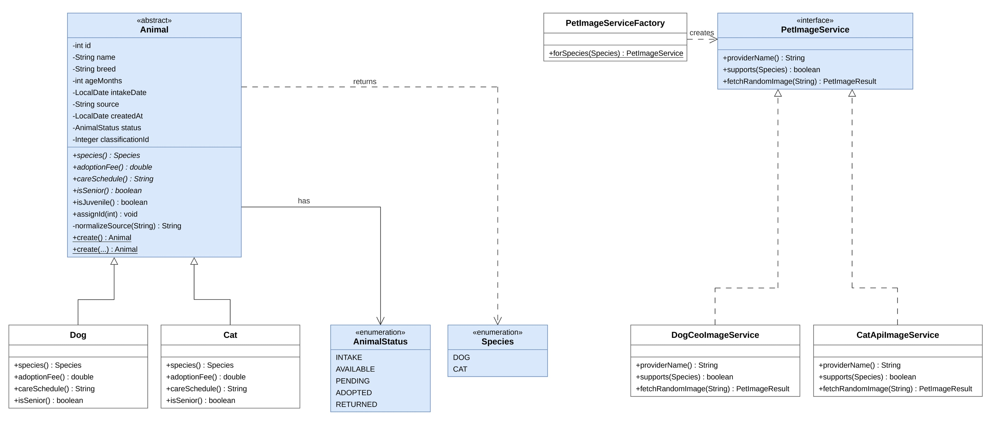
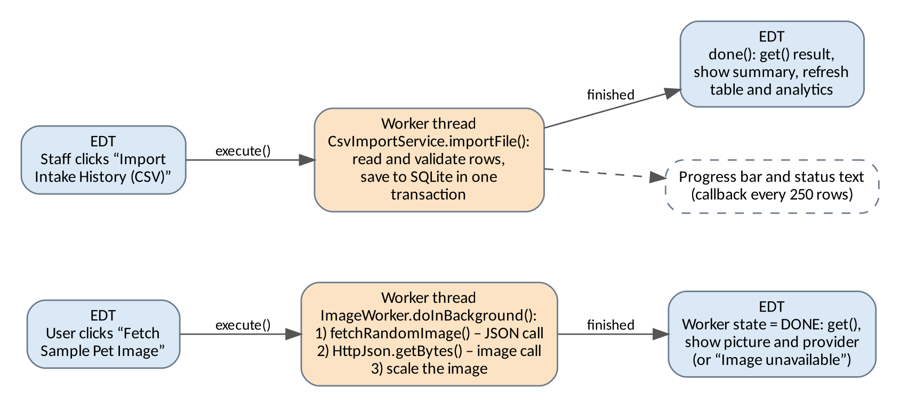
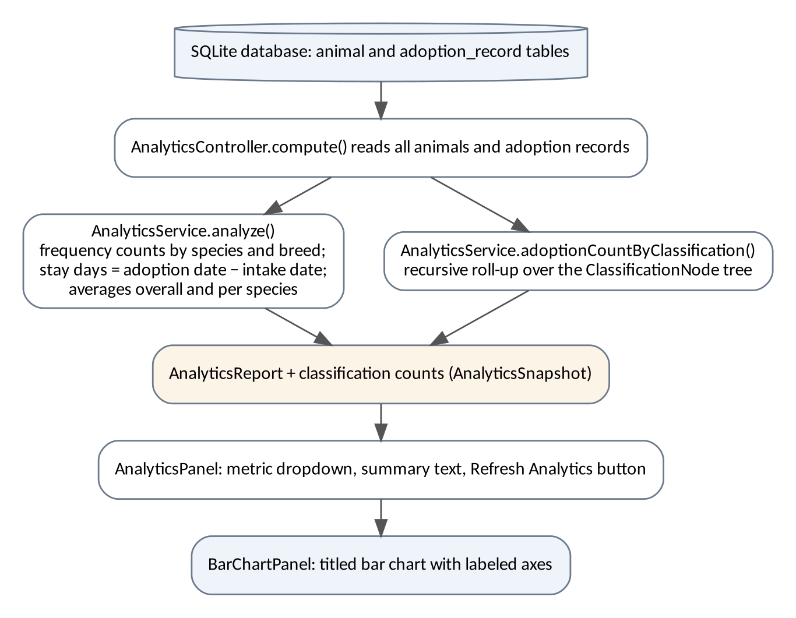

# Pet Shelter & Adoption Tracker
## Project Design Document

| Field | Details |
|---|---|
| **Group Name / No.:** | **Group 3** |
| **Members:** | |
| | Shann Michael Agang — UI Designer / Developer |
| | Sofia Yvonne Enovero — Team Lead / Developer |
| | Kyle Cheznie Taghoy — Quality Assurance |
| | Aeisha Mae Elizar — Database Admin |
| | Cleint Lausa — Developer |
| **Instructor:** | Richyll Son |
| **Term:** | First Semester, S.Y. 2026–2027 |
| **Document Version / Date:** | **V 0.4 — 11/17/2026** |

<br>

# Table of Contents
# Table of Contents

- [Revision History](#revision-history)
- [1. Introduction & Project Overview](#1-introduction--project-overview)
- [2. Preliminary ER Sketch & Team Roles](#2-preliminary-er-sketch--team-roles)
  - [2.1 Preliminary Entities and Key Attributes](#21-preliminary-entities-and-key-attributes)
  - [2.2 Preliminary Relationships and Cardinality](#22-preliminary-relationships-and-cardinality)
  - [2.3 Team Members and Primary Roles](#23-team-members-and-primary-roles)
- [3. System Architecture & Object-Oriented Design](#3-system-architecture--object-oriented-design)
  - [3.1 Class Hierarchy — PawTrack](#31-class-hierarchy---pawtrack-pet-shelter--adoption-tracker)
  - [3.2 Single Responsibility Principle Justification Table](#32-single-responsibility-principle-justification-table)
  - [3.3 Design Rationale: PawTrack](#33-design-rationale-pawtrack)
- [4. Data Model & Database Design](#4-data-model--database-design)
  - [4.1 ER Diagram](#41-er-diagram)
  - [4.2 SQLite Schema](#42-sqlite-schema)
- [5. API Integration Design](#5-api-integration-design)
  - [5.1 API 1: Dog CEO API](#51-api-1-dog-ceo-api)
  - [5.2 API 2: TheCatAPI](#52-api-2-thecatapi)
  - [5.3 Error Handling](#53-error-handling)
  - [5.4 Example JSON Responses](#54-example-json-responses)
- [6. Concurrency Design](#6-concurrency-design)
  - [6.1 Background Operations](#61-background-operations)
  - [6.2 How the Background Work Runs](#62-how-the-background-work-runs)
  - [6.3 Keeping the UI Responsive](#63-keeping-the-ui-responsive)
- [7. Data Mining & Visualization Design](#7-data-mining--visualization-design)
  - [7.1 Data Mining and Aggregation](#71-data-mining-and-aggregation)
  - [7.2 Recursive Classification Analysis](#72-recursive-classification-analysis)
  - [7.3 Data Visualization](#73-data-visualization)

   <br>
## Revision History

| Version | Date | Author | Changes |
|:---:|:---|:---|:---|
| 0.1 | Nov. 6, 2026 | Sofia Yvonne Enovero | Added Section 1 — Introduction. |
| | | Shann Michael Agang | Added Section 2 — Preliminary ER Design. |
| | | Kyle Cheznie Taghoy | Updated preliminary ER sketch. |
| | | Aeisha Mae Elizar | Updated Section 2 relationship table. |
| | | Cleint Lausa | Added team responsibilities. |
| 0.2 | Oct. 27, 2026 | Kyle Cheznie Taghoy | Added class hierarchy diagram. |
| | | Cleint Lausa | Updated SRP justification table. |
| | | Aeisha Mae Elizar | Added design rationale. |
| | | Sofia Yvonne Enovero | Updated ER diagram. |
| | | Shann Michael Agang | Added SQLite schema. |
| 0.3 | Nov. 3, 2026 | Kyle Cheznie Taghoy | Added API integration tables. |
| | | Aeisha Mae Elizar | Added error handling and JSON examples. |
| | | Shann Michael Agang | Added concurrency design. |
| | | Sofia Yvonne Enovero | Added data mining and aggregation. |
| | | Cleint Lausa | Added data visualization. |
| **0.4** | **Nov. 17, 2026** | Sofia Yvonne Enovero | Updated introduction and document formatting. |
| | | Shann Michael Agang | Revised architecture and SRP tables. |
| | | Aeisha Mae Elizar | Updated ERD and SQLite schema. |
| | | Cleint Lausa | Revised concurrency and analytics sections. |
| | | Kyle Cheznie Taghoy | Updated API integration, response examples, and error handling. |

<br>

## 1. Introduction & Project Overview

The Pet Shelter & Adoption Tracker (PawTrack) is a Java desktop application for animal shelters and prospective adopters. It centralizes animal profiles, adopter accounts, first-in-first-out (FIFO) waitlists, reservations, application reviews, adoption records, and shelter analytics. The project replaces scattered paper records and spreadsheets with a structured, locally stored workflow, while allowing adopters to browse animals, monitor their application status, and manage their account information.

PawTrack supports dogs and cats through an object-oriented Animal hierarchy with species-specific adoption fees, senior-age thresholds, and care schedules. Staff can manage animal records, review adoption applications, manage reservations, finalize adoptions, import historical CSV records, and view shelter analytics. Adopters can register, browse available animals, express or withdraw adoption interest, monitor their applications and reservations, receive status notifications, and manage their profiles. The system also supports locally stored pet photographs and text-based adoption receipts.

The application is developed using Java 17-compatible code, Swing, SQLite/JDBC, Maven, and JUnit 5. Core records and uploaded pet photographs are stored locally, while Dog CEO and TheCatAPI provide optional sample pet images that require an internet connection. Authentication uses salted PBKDF2 password hashing, and role-based access separates staff operations from adopter functions. The architecture separates domain models, data access, application services, controllers, and graphical interface components to support maintainability and the Single Responsibility Principle (SRP), although some responsibilities in MainFrame remain candidates for further refactoring.

<br>

## 2. Preliminary ER Sketch & Team Roles
## 2. Preliminary ER Sketch & Team Roles

### 2.1 Preliminary Entities and Key Attributes

**Table 1. Preliminary Entities and Key Attributes**

| Entity | Key Attributes | Description |
|---|---|---|
| Classification | id (PK), name, parent_id (FK → Classification.id, nullable) | Stores animal classifications and supports hierarchical parent-child relationships. |
| Animal | id (PK), name, species, breed, age_months, intake_date, status, classification_id (FK → Classification.id) | Stores animal information, shelter intake details, current status, and classification. |
| Adopter | id (PK), name, email (unique), phone | Stores information about individuals interested in adopting animals. |
| AdoptionRecord | id (PK), animal_id (FK → Animal.id), adopter_id (FK → Adopter.id), adoption_date, fee_paid | Records completed adoption transactions and their associated animal and adopter. |
| WaitlistEntry | id (PK), animal_id (FK → Animal.id), adopter_id (FK → Adopter.id), requested_at, position | Records adoption interest and maintains the order of prospective adopters for an animal. |

### 2.2 Preliminary Relationships and Cardinality

**Table 2. Preliminary Relationships and Cardinality**

| Parent Entity | Cardinality | Child Entity | Foreign Key | Description |
|---|---|---|---|---|
| Classification | 1:M | Classification | parent_id (nullable) | Self-referencing taxonomy tree of any depth, e.g., Dog → Sporting Group → Retriever → Golden Retriever. |
| Classification | 1:M | Animal | classification_id | Each animal may belong to one classification. |
| Animal | 1:M | AdoptionRecord | animal_id | An animal can be associated with adoption records that document its completed adoption transactions. |
| Adopter | 1:M | AdoptionRecord | adopter_id | An adopter can adopt multiple animals. |
| Animal | 1:M | WaitlistEntry | animal_id | An animal can have many adopters waiting. |
| Adopter | 1:M | WaitlistEntry | adopter_id | An adopter can have multiple waitlist entries for different animals. |

### 2.3 Team Members and Primary Roles

**Table 3. Team Members and Primary Roles**

| Member | Primary Responsibility |
|---|---|
| Sofia Yvonne Enovero | Team Lead / Developer |
| Shann Michael Agang | UI Designer / Developer |
| Cleint Lausa | Developer |
| Kyle Cheznie Taghoy | QA (Quality Assurance) |
| Aeisha Mae Elizar | Database Admin |


*Figure 2.1. Preliminary Entity-Relationship Sketch of PawTrack.*
<br>

## 3. System Architecture & Object-Oriented Design

### 3.1 Class Hierarchy — PawTrack: Pet Shelter & Adoption Tracker



*Figure 3.1. Class Hierarchy of PawTrack.*

### 3.2 Single Responsibility Principle Justification Table

PawTrack organizes its classes into models, API integrations, services, controllers, database and security components, and graphical interface components. Each layer is intended to manage a distinct responsibility, reducing unnecessary dependencies and supporting maintainability.

**Table 6. Class Hierarchy (Animals)**

| Class | Single Responsibility | Why It Follows SRP |
|---|---|---|
| Animal (abstract) | Stores and validates shared animal information, including identification, name, breed, age, intake date, status, and classification. Declares the species-specific methods `species()`, `adoptionFee()`, `careSchedule()`, and `isSenior()`. | Defines the common animal model and behavioral contract without handling database operations, graphical interfaces, or external API requests. |
| Dog | Implements dog-specific adoption fees, care schedules, and the senior-age threshold of 84 months. | Changes when dog-specific business rules change, without affecting the Cat subclass. |
| Cat | Implements cat-specific adoption fees, care schedules, and the senior-age threshold of 120 months. | Changes when cat-specific business rules change, independently of the Dog subclass. |
| Species (enum) | Defines the supported animal species, `DOG` and `CAT`. | Centralizes supported species values and their representations. |
| AnimalStatus (enum) | Defines the supported animal statuses, including `INTAKE`, `AVAILABLE`, `PENDING`, `ADOPTED`, and `RETURNED`. | Centralizes the animal status values and their representations. |

**Table 7. Image API Classes**

| Class | Single Responsibility | Why It Follows SRP |
|---|---|---|
| PetImageService (interface) | Defines the shared contract for retrieving pet images through methods such as `providerName()`, `supports(Species)`, and `fetchRandomImage(String)`. | Allows the application to depend on an abstraction instead of a specific external API provider. |
| DogCeoImageService | Communicates with the Dog CEO API and processes dog image responses. | Isolates Dog CEO integration requirements and response handling. |
| CatApiImageService | Communicates with TheCatAPI, handles its optional API key, and processes cat image responses. | Isolates TheCatAPI-specific integration requirements. |
| PetImageServiceFactory | Selects the appropriate PetImageService implementation based on the animal species. | Centralizes API provider selection outside the GUI and individual API implementations. |
| PetImageResult | Holds retrieved image information, including the image URL, species, breed, and provider. | Represents image-result data without directly performing network requests or GUI operations. |
| HttpJson | Performs HTTP GET requests and returns JSON response data. | Centralizes shared HTTP communication logic rather than repeating it across API services. |
| DogCeoResponse, CatImageDto | Represent the response structures returned by the Dog CEO API and TheCatAPI. | Separate API response data representations from network communication and interface logic. |
| ApiResult | Represents API outcomes through `Ok`, `Empty`, and `Failed` result states. | Provides a consistent representation of API outcomes without performing requests. |

**Table 8. Services and Data Structures**

| Class | Single Responsibility | Why It Follows SRP |
|---|---|---|
| WaitlistService | Manages the first-in-first-out (FIFO) queue of interested adopters for each animal. | Centralizes queue-management operations separately from GUI presentation and persistence responsibilities. |
| StatusHistoryService | Manages the stack of animal status changes used for undo operations. | Focuses on storing and retrieving status-change history. |
| StatusChange | Represents an individual status transition, including the animal's previous and updated statuses. | Stores status-change information without executing undo operations. |
| ClassificationService | Performs classification searches, recursive traversal, and classification path operations. | Centralizes classification-related processing and separates it from the user interface. |
| ClassificationNode | Represents a node in the hierarchical classification tree and maintains its child nodes. | Models the classification structure independently of database access and GUI presentation. |
| ShelterSeeder | Populates an empty database with sample shelter records. | Keeps initial sample-data generation separate from regular application operations. |
| CsvImportService | Parses, validates, and imports historical CSV records. | Encapsulates CSV import processing outside the GUI. Supporting types such as CsvRow, CsvImportResult, and ImportListener represent imported data, results, and progress callbacks. |
| AnalyticsService | Calculates adoption frequencies, average shelter stays, and recursive classification totals. | Separates analytics calculations from graphical chart rendering and user interaction. |
| AnalyticsReport | Holds the aggregated results produced by AnalyticsService. | Represents analytics output without performing calculations or drawing charts. |

**Table 9. Controller Layer**

| Class | Single Responsibility | Why It Follows SRP |
|---|---|---|
| AnimalController | Coordinates animal retrieval, registration, updating, deletion, and selection-related operations. | Provides an application-level interface between the GUI and animal persistence operations. |
| AdoptionController | Coordinates adoption-related operations, including recording interest, finalizing adoptions, and handling authorized status changes. | Centralizes adoption workflow coordination and authorization outside the GUI. |
| WaitlistController | Coordinates waitlist requests, queue advancement, and retrieval of interested adopters. | Connects waitlist business logic with the persistence layer and user interface. |
| ClassificationController | Coordinates animal filtering using classification paths. | Encapsulates classification filtering instead of placing the logic directly in GUI components. |
| ImportController | Coordinates CSV import execution, staff authorization, and background processing. | Separates import coordination and permission checks from the presentation layer. |
| AnalyticsController | Retrieves the data required for analytics and produces analytics snapshots through the service layer. | Separates analytics coordination from chart rendering and interface controls. |
| AuthController | Handles login, logout, account registration, and role-based authorization checks. | Centralizes authentication and authorization instead of implementing them separately in graphical screens. |

**Table 10. Database and Security Layers**

| Class | Single Responsibility | Why It Follows SRP |
|---|---|---|
| Database | Manages SQLite connection setup, foreign-key enforcement, database schema initialization, and required schema migrations. | Centralizes database configuration and schema management, while entity-specific queries and application workflows are handled in separate classes. |
| AnimalDao | Performs persistence operations for animal records. | Isolates animal-related SQL operations from business logic and interface components. |
| AdopterDao | Performs persistence operations for adopter information. | Centralizes adopter-related database operations. |
| AdoptionRecordDao | Performs persistence operations for completed adoption records. | Separates completed adoption-record storage from adoption workflow coordination. |
| ClassificationDao | Performs persistence operations for classification records and their hierarchical relationships. | Isolates classification-related SQL operations from classification processing. |
| WaitlistDao | Performs persistence operations for adoption waitlist entries. | Separates stored waitlist records from FIFO queue-management logic. |
| UserDao | Performs persistence operations for user accounts and their associated account information. | Keeps user-account SQL operations separate from authentication and GUI responsibilities. |
| Adopter, AdoptionRecord, User, Role | Represent adopter information, adoption transactions, authenticated user accounts, and access roles. | Hold domain and account information without directly performing database queries or graphical interface operations. |
| PasswordHasher | Hashes and verifies passwords using PBKDF2 with HmacSHA256, a random salt, and constant-time comparison. | Isolates password-processing responsibilities from login interfaces and account-management workflows. |
| PasswordPolicy | Validates passwords against the application's defined password requirements. | Centralizes password validation rules instead of duplicating them across account-related screens. |

**Table 11. Graphical User Interface Layer**

| Class | Single Responsibility | Why It Follows SRP |
|---|---|---|
| MainFrame | Coordinates the main application window, role-based navigation, and interactions among graphical components and application controllers. | Primarily manages presentation and event coordination. However, some direct database access and workflow responsibilities remain, indicating opportunities for further separation into controllers and services. |
| LoginPanel | Provides the user login interface and collects authentication input. | Handles login presentation while delegating authentication processing to AuthController. |
| CreateAccountPanel | Provides the account registration interface and collects registration information. | Separates registration input and presentation from account creation logic. |
| AnimalTableModel | Supplies animal information to Swing table components. | Focuses on organizing and presenting animal records in a table-compatible format. |
| AnalyticsPanel | Displays analytics controls, summary information, and visualization selections. | Manages analytics presentation while calculations are delegated to analytics-related components. |
| BarChartPanel | Draws bar charts representing aggregated analytics results. | Focuses on chart rendering rather than calculating the underlying statistics. |
| ImageWorker | Retrieves and processes external pet images on a background thread. | Separates image-loading operations from GUI event handling to improve responsiveness. |
| ImportWorker | Supports CSV import execution through background processing. | Separates long-running import execution from direct GUI processing. Its responsibilities overlap with the worker logic coordinated by ImportController and may be consolidated during further refactoring. |
| RoundedUi, Icons | Provide reusable graphical styling components and application icon resources. | Centralize visual styling and icon handling instead of duplicating them across interface classes. |

### 3.3 Design Rationale: PawTrack

PawTrack applies object-oriented design principles, reusable architectural patterns, and fundamental data structures to support maintainability and organized development. The abstract Animal class defines shared attributes and behaviors, while the Dog and Cat subclasses implement species-specific adoption fees, senior-age thresholds, and care schedules. The `Animal.create()` factory method creates the appropriate subclass based on the selected species. Through inheritance and polymorphism, different animal types can be managed using a common Animal reference while preserving species-specific behavior.

The application separates responsibilities across model, data access, service, controller, and graphical interface layers. DAO classes handle SQLite persistence, services implement business logic and data-structure operations, and controllers coordinate workflows and authorization. Key structures include a FIFO queue for adoption waitlists, a stack for undo operations, and a classification tree supporting recursive traversal. Image retrieval is abstracted through the PetImageService interface and selected via PetImageServiceFactory. Background workers handle tasks such as image retrieval and CSV importing to keep the Swing Event Dispatch Thread responsive. While the design generally follows the Single Responsibility Principle, some workflow responsibilities remain in MainFrame, presenting opportunities for future refactoring.

<br>

## 4. Data Model & Database Design

### 4.1 ER Diagram


*Figure 4.1. Finalized Entity-Relationship Diagram of PawTrack. PK = Primary Key, FK = Foreign Key, NN = NOT NULL.*

### 4.2 SQLite Schema

PawTrack uses SQLite as its local relational database, accessed through JDBC. The Database class initializes the required tables, enables foreign-key enforcement using `PRAGMA foreign_keys = ON`, and performs additive schema migrations to support existing database files.

**Table 12. Core Database Tables**

| Table | Columns and Constraints |
|---|---|
| `classification` | `id INTEGER PK AUTOINCREMENT`; `name TEXT NOT NULL`; `parent_id INTEGER FK → classification.id ON DELETE CASCADE` |
| `animal` | `id INTEGER PK AUTOINCREMENT`; `name`, `species`, `breed`, `intake_date`, `status TEXT NOT NULL`; `age_months INTEGER NOT NULL CHECK ≥ 0`; `classification_id INTEGER FK → classification.id`; `source TEXT NOT NULL DEFAULT 'stray'`; `created_at TEXT NOT NULL DEFAULT current local date` |
| `adopter` | `id INTEGER PK AUTOINCREMENT`; `name TEXT NOT NULL`; `email TEXT NOT NULL UNIQUE COLLATE NOCASE`; `phone TEXT`; `created_at TEXT NOT NULL DEFAULT current local date` |
| `adoption_record` | `id INTEGER PK AUTOINCREMENT`; `animal_id INTEGER NOT NULL FK → animal.id ON DELETE CASCADE`; `adopter_id INTEGER NOT NULL FK → adopter.id ON DELETE CASCADE`; `adoption_date TEXT NOT NULL`; `fee_paid REAL NOT NULL DEFAULT 0` |
| `waitlist_entry` | `id INTEGER PK AUTOINCREMENT`; `animal_id INTEGER NOT NULL FK → animal.id ON DELETE CASCADE`; `adopter_id INTEGER NOT NULL FK → adopter.id ON DELETE CASCADE`; `requested_at TEXT NOT NULL`; `position INTEGER NOT NULL`; `UNIQUE(animal_id, adopter_id)` |
| `users` | `id INTEGER PK AUTOINCREMENT`; `username TEXT NOT NULL UNIQUE`; `password_hash`, `password_salt TEXT NOT NULL`; `role TEXT NOT NULL CHECK ('STAFF','ADOPTER')`; `adopter_id INTEGER FK → adopter.id` |

**Table 13. Adoption and Reservation Tables**

| Table | Columns and Constraints |
|---|---|
| `adoption_reservation` | `id INTEGER PK AUTOINCREMENT`; `animal_id INTEGER NOT NULL FK → animal.id ON DELETE CASCADE`; `adopter_id INTEGER NOT NULL FK → adopter.id ON DELETE CASCADE`; `reserved_at`, `expires_at TEXT NOT NULL`; `status TEXT NOT NULL CHECK ('ACTIVE','COMPLETED','CANCELLED','EXPIRED')` |
| `application_review` | `animal_id INTEGER NOT NULL FK → animal.id ON DELETE CASCADE`; `adopter_id INTEGER NOT NULL FK → adopter.id ON DELETE CASCADE`; `status TEXT NOT NULL CHECK ('UNDER_REVIEW','APPROVED')`; `staff_note TEXT NOT NULL DEFAULT ''`; `updated_at TEXT NOT NULL`; composite `PK(animal_id, adopter_id)` |
| `adoption_application` | `id INTEGER PK AUTOINCREMENT`; `animal_id INTEGER NOT NULL FK → animal.id`; `adopter_id INTEGER NOT NULL FK → adopter.id`; `applicant_name`, `applicant_email`, `answers`, `status`, `submitted_at`, `updated_at TEXT NOT NULL`; `applicant_phone`, `applicant_address TEXT`; `reviewed_by INTEGER FK → users.id`; `reviewed_at TEXT`; `staff_message TEXT NOT NULL DEFAULT ''` |
| `adoption_application_history` | `id INTEGER PK AUTOINCREMENT`; `application_id INTEGER NOT NULL FK → adoption_application.id`; `status TEXT NOT NULL`; `actor_id INTEGER FK → users.id`; `note TEXT`; `occurred_at TEXT NOT NULL` |

**Table 14. Notification and Account Management Tables**

| Table | Columns and Constraints |
|---|---|
| `notification_read` | `user_id INTEGER NOT NULL FK → users.id ON DELETE CASCADE`; `reservation_id INTEGER NOT NULL FK → adoption_reservation.id ON DELETE CASCADE`; `status TEXT NOT NULL`; composite `PK(user_id, reservation_id, status)` |
| `application_notice_read` | `user_id INTEGER NOT NULL FK → users.id`; `application_id INTEGER NOT NULL FK → adoption_application.id`; `status`, `updated_at TEXT NOT NULL`; composite `PK(user_id, application_id, status, updated_at)` |
| `account_preferences` | `user_id INTEGER NOT NULL FK → users.id ON DELETE CASCADE`; `pref_key`, `pref_value TEXT NOT NULL`; composite `PK(user_id, pref_key)` |
| `account_profile` | `user_id INTEGER PK and FK → users.id ON DELETE CASCADE`; `full_name`, `email`, `phone`, `address`, `preferred_contact TEXT` |

PawTrack uses additional unique indexes to prevent multiple active reservations for the same animal, duplicate active applications from the same adopter for the same animal, and multiple accounts referencing the same adopter profile. Schema migrations add missing animal source and creation-date fields and adopter creation dates, while repairing invalid adopter-account links without deleting existing records.

## 5. API Integration Design

PawTrack integrates two public REST APIs, Dog CEO and TheCatAPI, to retrieve sample pet images for dogs and cats. Both integrations implement the `PetImageService` interface, while `PetImageServiceFactory` selects the appropriate provider based on the animal's species. HTTP GET requests are handled through `HttpJson`, with 8-second connection and read timeouts. The responses are parsed using Gson and org.json, and the retrieved image information is represented through `PetImageResult`. Image retrieval is performed in the background to maintain user interface responsiveness.

### 5.1 API 1: Dog CEO API (https://dog.ceo/dog-api/)

The Dog CEO API provides dog images and a breed catalogue without requiring an API key. PawTrack uses this API to retrieve images that correspond to the animal's recorded breed whenever a suitable match is available.

**Table 15. Dog CEO API Integration**

| Endpoint (HTTP GET) | JSON Response Shape | Parsing and Use in PawTrack |
|---|---|---|
| `https://dog.ceo/api/breeds/list/all` | `message`: object mapping breeds to lists of sub-breeds; `status`: request status | Parsed using org.json to retrieve available breeds and sub-breeds. For example, retriever and golden are converted into Golden Retriever for breed matching. |
| `https://dog.ceo/api/breed/{path}/images/random` | `message`: image URL string; `status`: request status | Parsed into `DogCeoResponse`. The returned URL is stored in `PetImageResult` and used to retrieve a dog image corresponding to the requested breed. |
| `https://dog.ceo/api/breeds/image/random` | `message`: random dog image URL; `status`: request status | Used when a general dog image is requested. It provides an alternative when a breed-specific image cannot be determined. |

### 5.2 API 2: TheCatAPI (https://thecatapi.com/)

TheCatAPI provides cat images and breed information. It supports optional API-key authentication, with the key supplied through the `CAT_API_KEY` environment variable or `cat.api.key` system property. When available, the API key is included in the `x-api-key` request header.

**Table 16. TheCatAPI Integration**

| Endpoint (HTTP GET) | JSON Response Shape | Parsing and Use in PawTrack |
|---|---|---|
| `https://api.thecatapi.com/v1/breeds` | Array of breed objects containing fields such as `id` and `name` | Parses the breed catalogue and matches the animal's recorded breed to the corresponding API breed identifier. |
| `https://api.thecatapi.com/v1/images/search?limit=1&has_breeds=1` | Array of image objects containing `id`, `url`, image dimensions, and optional breed information | Parses the JSON response into `CatImageDto`. The image URL is extracted and used to retrieve a sample cat image. Breed-filtered requests may be used when a matching breed identifier is available. |

### 5.3 Error Handling

PawTrack handles external API failures without interrupting its core shelter operations. Image retrieval executes in the background, and the application handles the following conditions:

- **Connection timeout:** Requests use connection and read timeouts to prevent indefinite waiting.
- **Unsuccessful HTTP response:** Responses outside the successful HTTP status range are treated as request failures.
- **Invalid JSON response:** Missing, malformed, or incomplete response data is handled as an unsuccessful image request.
- **Unavailable image:** The interface reports that the image could not be retrieved instead of displaying an invalid result.
- **Unmatched breed:** The image services may use a general random image when a suitable breed-specific image is unavailable.

The application's core functions, including animal management, adoption records, waitlists, CSV importing, and analytics, use local SQLite storage and do not depend on the availability of either external image API.

### 5.4 Example JSON Responses

**Example 1. Dog CEO API — Breed Catalogue**

```json
{
  "message": {
    "labrador": [],
    "retriever": ["chesapeake", "curly", "flatcoated", "golden"]
  },
  "status": "success"
}
```

The `message` object lists available breeds and sub-breeds. PawTrack processes this information to support dog breed matching.

**Example 2. Dog CEO API — Random Breed Image**

```json
{
  "message": "https://images.dog.ceo/breeds/retriever-golden/n02099601_1024.jpg",
  "status": "success"
}
```

The response contains the image URL in the `message` field, which is used to retrieve the corresponding dog image.

**Example 3. TheCatAPI — Image Search**

```json
[
  {
    "id": "aXYvRd7Do",
    "url": "https://cdn2.thecatapi.com/images/aXYvRd7Do.jpg",
    "width": 1445,
    "height": 1080,
    "breeds": [
      {
        "id": "abys",
        "name": "Abyssinian"
      }
    ]
  }
]
```

The response contains an image URL and associated metadata. PawTrack extracts the image URL and processes the available breed information for display.

## 6. Concurrency Design

PawTrack uses Java Swing's `SwingWorker` to run long operations on background threads, so the Event Dispatch Thread (EDT), which handles clicks and repainting, is not blocked.

### 6.1 Background Operations

**Table 13: Background operations and threading approach**

| Operation | Background worker | Threading approach |
|---|---|---|
| Bulk CSV import | `SwingWorker` created in `ImportController.importCsv()` (`ImportWorker` is an equivalent stand-alone class) | `doInBackground()` calls `CsvImportService.importFile()`, which reads and validates each row and saves animals, adopters, and adoption records to SQLite in one transaction (committed at the end, rolled back on failure). Progress is reported as a percentage every 250 rows. `done()` runs on the EDT and reads the result with `get()`. |
| Pet image retrieval | `ImageWorker` | `SwingWorker<ImageWorker.Result, Void>`. `doInBackground()` asks the `PetImageService` for an image URL, downloads the image bytes, and scales the image. The GUI listens for the worker's `DONE` state. |
| Analytics refresh | None (runs on the EDT) | `AnalyticsController.compute()` reads the local SQLite data and makes one in-memory pass. It runs after data changes, when Refresh Analytics is clicked, and with F5. |



*Figure 4: Which steps run on the EDT (blue) and which on a worker thread (orange) for CSV import and image retrieval.*

### 6.2 How the Background Work Runs

The import is the longest operation. The worker computes the percentage from the number of rows processed and the number of lines in the file, and reports it every 250 rows. The image worker makes two network calls, one for the image URL and one for the image itself, and neither runs on the EDT.

### 6.3 Keeping the UI Responsive

- **While an import runs:** the status bar says the import is running on a background thread, and the progress bar shows the percentage.
- **When a worker finishes:** for an import, the GUI reads the result, shows the summary in the status bar and the Activity Log, then refreshes the animal table and the analytics. For an image, it shows the picture, the provider, and the breed.
- **If a worker fails:** the GUI shows an "Import failed" message or "Image unavailable", and the application continues.

Because the long work runs off the EDT, the window keeps repainting and accepting clicks during an import or an image download.

---

## 7. Data Mining & Visualization Design

PawTrack uses `AnalyticsService` to analyze the animal and adoption records stored in the SQLite database. It performs frequency analysis to find the most adopted species and breeds, calculates average shelter stay, and aggregates adoption counts through the classification hierarchy. The results are returned as an `AnalyticsReport` and shown on the analytics dashboard. The sample intake log in `data/intake_history.csv` contains 6,000 records, so the charts reflect real volumes of data.

### 7.1 Data Mining and Aggregation

The service matches each completed adoption record with its animal, groups and counts the records by species and breed, calculates stay durations, and performs a recursive roll-up through the classification tree.

**Table 14: Data mining and aggregation operations**

| Analysis | Aggregation method | Purpose |
|---|---|---|
| Adoptions by Species | Counts completed adoption records for each species and sorts from highest to lowest (name breaks ties). | Identifies the species with the most adoptions. |
| Adoptions by Breed | Counts completed adoption records for each breed and ranks them by frequency. | Identifies the most adopted breeds. |
| Average Shelter Stay | Calculates the days between an animal's intake date and adoption date (negative values from bad data count as 0), then computes the overall and per-species averages. | Shows how long animals usually stay before adoption. |
| Adoptions by Classification | Recursively counts animals with status ADOPTED under each classification node, including all descendant nodes. | Gives adoption totals across the classification hierarchy. |



*Figure 5: Data flow from the database to the chart.*

The analysis reads the live records each time it runs. The analytics refresh after interest is recorded, an animal is adopted, a status is undone, or a CSV file is imported, and whenever Refresh Analytics is clicked, so the results and charts change whenever the underlying data changes.

### 7.2 Recursive Classification Analysis

`ClassificationService` and `ClassificationNode` organize breeds into a tree stored in the `classification` table (each row points to its parent). The tree has no fixed depth, for example: Dog > Sporting Group > Retriever > Golden Retriever. Recursive methods search for classifications by name or by full path, build paths, and walk the tree. During analytics, `AnalyticsService.adoptionCountByClassification()` calls itself on each child node and adds the children's totals to the node's own count, so each node reports its own adopted animals plus all of its descendants. This lets staff compare adoption patterns at different levels of the hierarchy instead of only by species or breed name.

### 7.3 Data Visualization

PawTrack uses a bar chart, drawn by the `BarChartPanel` class, because a bar chart compares a number across separate categories such as species, breeds, and classifications. Each chart has a title, a labeled category axis, a labeled value axis, and value labels on the bars. No legend is needed because each chart shows one series. `AnalyticsPanel` provides a metric dropdown and a Refresh Analytics button; if there is no adoption history yet, the chart says to import the CSV intake log.

**Table 15: Analytics dashboard visualizations**

| Chart (dropdown choice) | Data displayed | Axis labels | Purpose |
|---|---|---|---|
| Adoptions by Species | Completed adoptions per species | Species / Adoptions | Compare adoption frequency |
| Top Adopted Breeds (Top 8) | The eight breeds with the most adoptions | Breed / Adoptions | Highlight the most adopted breeds |
| Average Shelter Stay (days) by Species | Average shelter days per species | Species / Days | Compare stay length |
| Adoptions by Classification (recursive) | Adoptions per classification, including descendants (up to 12 non-zero entries) | Classification / Adoptions | Show adoption spread across the hierarchy |

The dashboard also shows a text summary: total animals, completed adoptions, most adopted species and breed, average shelter stay, and adopters currently on waitlists.

---
