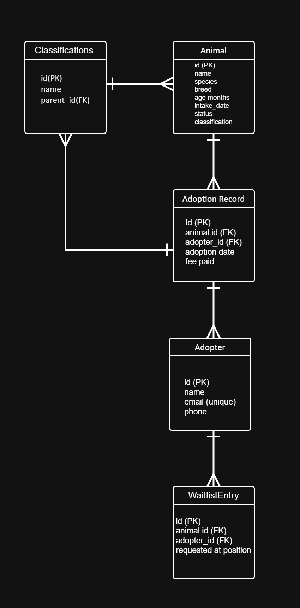
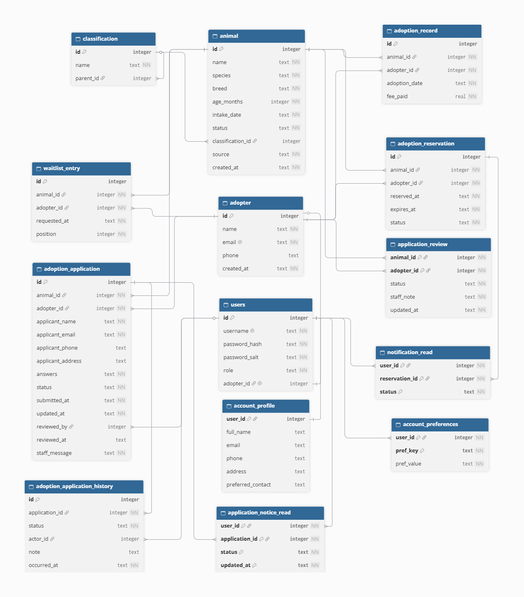
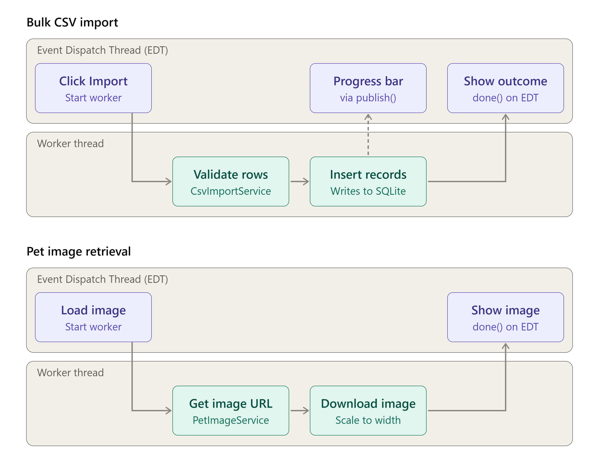
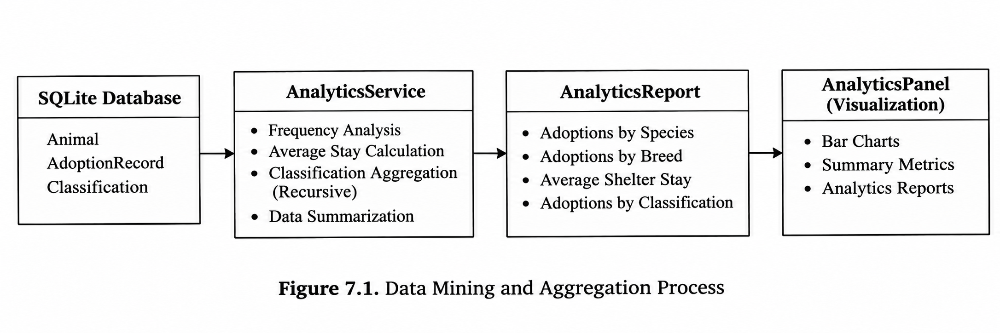

# Pet Shelter & Adoption Tracker

## Project Design Document

| Field                        | Details                                       |
| :--------------------------- | :-------------------------------------------- |
| **Group Name / No.:**        | **Group 3**                                   |
| **Members:**                 |                                               |
|                              | Shann Michael Agang — UI Designer / Developer |
|                              | Sofia Yvonne Enovero — Team Lead / Developer  |
|                              | Kyle Cheznie Taghoy — Quality Assurance       |
|                              | Aeisha Mae Elizar — Database Admin            |
|                              | Cleint Lausa — Developer                      |
| **Instructor:**              | Richyll Son                                   |
| **Term:**                    | First Semester, S.Y. 2026–2027                |
| **Document Version / Date:** | **V 0.5 — 11/18/2026**                        |


# Table of Contents

- [Revision History](#revision-history)
- [1. Introduction & Project Overview](#1-introduction--project-overview)
- [2. Preliminary ER Sketch & Team Roles](#2-preliminary-er-sketch--team-roles)
  - [2.1 Preliminary Entities and Key Attributes](#21-preliminary-entities-and-key-attributes)
  - [2.2 Preliminary Relationships and Cardinality](#22-preliminary-relationships-and-cardinality)
  - [2.3 Team Members and Primary Roles](#23-team-members-and-primary-roles)
- [3. System Architecture & Object-Oriented Design](#3-system-architecture--object-oriented-design)
  - [3.1 Class Hierarchy — PawTrack: Pet Shelter & Adoption Tracker](#31-class-hierarchy--pawtrack-pet-shelter--adoption-tracker)
  - [3.2 Single Responsibility Principle Justification Table](#32-single-responsibility-principle-justification-table)
  - [3.3 Design Rationale: PawTrack](#33-design-rationale-pawtrack)
- [4. Data Model & Database Design](#4-data-model--database-design)
  - [4.1 ER Diagram](#41-er-diagram)
  - [4.2 SQLite Schema](#42-sqlite-schema)
- [5. API Integration Design](#5-api-integration-design)
  - [5.1 API 1: Dog CEO API](#51-api-1-dog-ceo-api)
  - [5.2 API 2: TheCatAPI](#52-api-2-thecatapi)
  - [5.3 Error Handling](#53-error-handling)
  - [5.4 Example JSON Responses](#54-example-json-responses)
- [6. Concurrency Design](#6-concurrency-design)
  - [6.1 Background Operations](#61-background-operations)
  - [6.2 How the Background Work Runs](#62-how-the-background-work-runs)
  - [6.3 Keeping the UI Responsive](#63-keeping-the-ui-responsive)
- [7. Data Mining & Visualization Design](#7-data-mining--visualization-design)
  - [7.1 Data Mining and Aggregation](#71-data-mining-and-aggregation)
  - [7.2 Recursive Classification Analysis](#72-recursive-classification-analysis)
  - [7.3 Data Visualization](#73-data-visualization)
- [8. Testing Summary](#8-testing-summary)
  - [8.1 Test Suite Overview](#81-test-suite-overview)
  - [8.2 Test Classes and Edge Cases](#82-test-classes-and-edge-cases)
  - [8.3 Test Results and Quality Assessment](#83-test-results-and-quality-assessment)
- [9. Individual Contributions](#9-individual-contributions)
  - [9.1 Team Member Contributions](#91-team-member-contributions)
  - [9.2 Git Repository Contributions](#92-git-repository-contributions)
  - [9.3 Team Collaboration and Integration](#93-team-collaboration-and-integration)
- [Appendix](#appendix)
  - [Appendix A. Build and Run Instructions](#appendix-a-build-and-run-instructions)
  - [Appendix B. Automated Testing](#appendix-b-automated-testing)
  - [Appendix C. Known Limitations](#appendix-c-known-limitations)
  - [Appendix D. Supporting Materials](#appendix-d-supporting-materials)


## Revision History

| Version | Date              | Author               | Changes                                                                                                                           |
| :-----: | :---------------- | :------------------- | :-------------------------------------------------------------------------------------------------------------------------------- |
|   0.1   | Nov. 6, 2026      | Sofia Yvonne Enovero | Added Section 1 — Introduction.                                                                                                   |
|         |                   | Shann Michael Agang  | Added Section 2 — Preliminary ER Design.                                                                                          |
|         |                   | Kyle Cheznie Taghoy  | Updated preliminary ER sketch.                                                                                                    |
|         |                   | Aeisha Mae Elizar    | Updated Section 2 relationship table.                                                                                             |
|         |                   | Cleint Lausa         | Added team responsibilities.                                                                                                      |
|   0.2   | Oct. 27, 2026     | Kyle Cheznie Taghoy  | Added class hierarchy diagram.                                                                                                    |
|         |                   | Cleint Lausa         | Updated SRP justification table.                                                                                                  |
|         |                   | Aeisha Mae Elizar    | Added design rationale.                                                                                                           |
|         |                   | Sofia Yvonne Enovero | Updated ER diagram.                                                                                                               |
|         |                   | Shann Michael Agang  | Added SQLite schema.                                                                                                              |
|   0.3   | Nov. 3, 2026      | Kyle Cheznie Taghoy  | Added API integration tables.                                                                                                     |
|         |                   | Aeisha Mae Elizar    | Added error handling and JSON examples.                                                                                           |
|         |                   | Shann Michael Agang  | Added concurrency design.                                                                                                         |
|         |                   | Sofia Yvonne Enovero | Added data mining and aggregation.                                                                                                |
|         |                   | Cleint Lausa         | Added data visualization.                                                                                                         |
| **0.4** | **Nov. 17, 2026** | Sofia Yvonne Enovero | Updated introduction and document formatting.                                                                                     |
|         |                   | Shann Michael Agang  | Revised architecture and SRP tables.                                                                                              |
|         |                   | Aeisha Mae Elizar    | Updated ERD and SQLite schema.                                                                                                    |
|         |                   | Cleint Lausa         | Revised concurrency and analytics sections.                                                                                       |
|         |                   | Kyle Cheznie Taghoy  | Updated API integration, response examples, and error handling.                                                                   |
| **0.5** | **Nov. 18, 2026** | Kyle Cheznie Taghoy  | Updated Section 8 with automated test results, test classes, and edge cases.                                                      |
|         |                   | Sofia Yvonne Enovero | Updated Section 9 with individual contributions and Git commit records. Finalized the document version, contents, and formatting. |


## 1. Introduction & Project Overview

The Pet Shelter & Adoption Tracker (PawTrack) is a Java desktop application for animal shelters and prospective adopters. It centralizes animal profiles, adopter accounts, first-in-first-out (FIFO) waitlists, reservations, application reviews, adoption records, and shelter analytics. The project replaces scattered paper records and spreadsheets with a structured, locally stored workflow, while allowing adopters to browse animals, monitor their application status, and manage their account information.

PawTrack supports dogs and cats through an object-oriented Animal hierarchy with species-specific adoption fees, senior-age thresholds, and care schedules. Staff can manage animal records, review adoption applications, manage reservations, finalize adoptions, import historical CSV records, and view shelter analytics. Adopters can register, browse available animals, express or withdraw adoption interest, monitor their applications and reservations, receive status notifications, and manage their profiles. The system also supports locally stored pet photographs and text-based adoption receipts.

The application is developed using Java 17-compatible code, Swing, SQLite/JDBC, Maven, and JUnit 5. Core records and uploaded pet photographs are stored locally, while Dog CEO and TheCatAPI provide optional sample pet images that require an internet connection. Authentication uses salted PBKDF2 password hashing, and role-based access separates staff operations from adopter functions. The architecture separates domain models, data access, application services, controllers, and graphical interface components to support maintainability and the Single Responsibility Principle (SRP), although some responsibilities in MainFrame remain candidates for further refactoring.


## 2. Preliminary ER Sketch & Team Roles

### 2.1 Preliminary Entities and Key Attributes

**Table 1. Preliminary Entities and Key Attributes**

| Entity         | Key Attributes                                                                                             | Description                                                                              |
| :------------- | :--------------------------------------------------------------------------------------------------------- | :--------------------------------------------------------------------------------------- |
| Classification | id (PK), name, parent_id (FK → Classification.id, nullable)                                                | Stores animal classifications and supports hierarchical parent-child relationships.      |
| Animal         | id (PK), name, species, breed, age_months, intake_date, status, classification_id (FK → Classification.id) | Stores animal information, shelter intake details, current status, and classification.   |
| Adopter        | id (PK), name, email (unique), phone                                                                       | Stores information about individuals interested in adopting animals.                     |
| AdoptionRecord | id (PK), animal_id (FK → Animal.id), adopter_id (FK → Adopter.id), adoption_date, fee_paid                 | Records completed adoption transactions and their associated animal and adopter.         |
| WaitlistEntry  | id (PK), animal_id (FK → Animal.id), adopter_id (FK → Adopter.id), requested_at, position                  | Records adoption interest and maintains the order of prospective adopters for an animal. |

### 2.2 Preliminary Relationships and Cardinality

**Table 2. Preliminary Relationships and Cardinality**

| Parent Entity  | Cardinality | Child Entity   | Foreign Key          | Description                                                                                             |
| :------------- | :---------- | :------------- | :------------------- | :------------------------------------------------------------------------------------------------------ |
| Classification | 1:M         | Classification | parent_id (nullable) | Self-referencing taxonomy tree of any depth, e.g., Dog → Sporting Group → Retriever → Golden Retriever. |
| Classification | 1:M         | Animal         | classification_id    | Each animal may belong to one classification.                                                           |
| Animal         | 1:M         | AdoptionRecord | animal_id            | An animal can be associated with adoption records that document its completed adoption transactions.    |
| Adopter        | 1:M         | AdoptionRecord | adopter_id           | An adopter can adopt multiple animals.                                                                  |
| Animal         | 1:M         | WaitlistEntry  | animal_id            | An animal can have many adopters waiting.                                                               |
| Adopter        | 1:M         | WaitlistEntry  | adopter_id           | An adopter can have multiple waitlist entries for different animals.                                    |

### 2.3 Team Members and Primary Roles

**Table 3. Team Members and Primary Roles**

| Member               | Primary Responsibility  |
| :------------------- | :---------------------- |
| Sofia Yvonne Enovero | Team Lead / Developer   |
| Shann Michael Agang  | UI Designer / Developer |
| Cleint Lausa         | Developer               |
| Kyle Cheznie Taghoy  | QA (Quality Assurance)  |
| Aeisha Mae Elizar    | Database Admin          |



*Figure 2.1. Preliminary Entity-Relationship Sketch of PawTrack.*


## 3. System Architecture & Object-Oriented Design

### 3.1 Class Hierarchy — PawTrack: Pet Shelter & Adoption Tracker


*Figure 3.1. Class Hierarchy of PawTrack.*

### 3.2 Single Responsibility Principle Justification Table

PawTrack organizes its classes into models, API integrations, services, controllers, database and security components, and graphical interface components. Each layer is intended to manage a distinct responsibility, reducing unnecessary dependencies and supporting maintainability.

**Table 6. Class Hierarchy (Animals)**

| Class               | Single Responsibility                                                                                                                                                                                                                        | Why It Follows SRP                                                                                                                            |
| :------------------ | :------------------------------------------------------------------------------------------------------------------------------------------------------------------------------------------------------------------------------------------- | :-------------------------------------------------------------------------------------------------------------------------------------------- |
| Animal (abstract)   | Stores and validates shared animal information, including identification, name, breed, age, intake date, status, and classification. Declares the species-specific methods `species()`, `adoptionFee()`, `careSchedule()`, and `isSenior()`. | Defines the common animal model and behavioral contract without handling database operations, graphical interfaces, or external API requests. |
| Dog                 | Implements dog-specific adoption fees, care schedules, and the senior-age threshold of 84 months.                                                                                                                                            | Changes when dog-specific business rules change, without affecting the Cat subclass.                                                          |
| Cat                 | Implements cat-specific adoption fees, care schedules, and the senior-age threshold of 120 months.                                                                                                                                           | Changes when cat-specific business rules change, independently of the Dog subclass.                                                           |
| Species (enum)      | Defines the supported animal species, `DOG` and `CAT`.                                                                                                                                                                                       | Centralizes supported species values and their representations.                                                                               |
| AnimalStatus (enum) | Defines the supported animal statuses, including `INTAKE`, `AVAILABLE`, `PENDING`, `ADOPTED`, and `RETURNED`.                                                                                                                                | Centralizes the animal status values and their representations.                                                                               |

**Table 7. Image API Classes**

| Class                       | Single Responsibility                                                                                                                                | Why It Follows SRP                                                                              |
| :-------------------------- | :--------------------------------------------------------------------------------------------------------------------------------------------------- | :---------------------------------------------------------------------------------------------- |
| PetImageService (interface) | Defines the shared contract for retrieving pet images through methods such as `providerName()`, `supports(Species)`, and `fetchRandomImage(String)`. | Allows the application to depend on an abstraction instead of a specific external API provider. |
| DogCeoImageService          | Communicates with the Dog CEO API and processes dog image responses.                                                                                 | Isolates Dog CEO integration requirements and response handling.                                |
| CatApiImageService          | Communicates with TheCatAPI, handles its optional API key, and processes cat image responses.                                                        | Isolates TheCatAPI-specific integration requirements.                                           |
| PetImageServiceFactory      | Selects the appropriate PetImageService implementation based on the animal species.                                                                  | Centralizes API provider selection outside the GUI and individual API implementations.          |
| PetImageResult              | Holds retrieved image information, including the image URL, species, breed, and provider.                                                            | Represents image-result data without directly performing network requests or GUI operations.    |
| HttpJson                    | Performs HTTP GET requests and returns JSON response data.                                                                                           | Centralizes shared HTTP communication logic rather than repeating it across API services.       |
| DogCeoResponse, CatImageDto | Represent the response structures returned by the Dog CEO API and TheCatAPI.                                                                         | Separate API response data representations from network communication and interface logic.      |
| ApiResult                   | Represents API outcomes through `Ok`, `Empty`, and `Failed` result states.                                                                           | Provides a consistent representation of API outcomes without performing requests.               |

**Table 8. Services and Data Structures**

| Class                 | Single Responsibility                                                                             | Why It Follows SRP                                                                                                                                                                 |
| :-------------------- | :------------------------------------------------------------------------------------------------ | :--------------------------------------------------------------------------------------------------------------------------------------------------------------------------------- |
| WaitlistService       | Manages the first-in-first-out (FIFO) queue of interested adopters for each animal.               | Centralizes queue-management operations separately from GUI presentation and persistence responsibilities.                                                                         |
| StatusHistoryService  | Manages the stack of animal status changes used for undo operations.                              | Focuses on storing and retrieving status-change history.                                                                                                                           |
| StatusChange          | Represents an individual status transition, including the animal's previous and updated statuses. | Stores status-change information without executing undo operations.                                                                                                                |
| ClassificationService | Performs classification searches, recursive traversal, and classification path operations.        | Centralizes classification-related processing and separates it from the user interface.                                                                                            |
| ClassificationNode    | Represents a node in the hierarchical classification tree and maintains its child nodes.          | Models the classification structure independently of database access and GUI presentation.                                                                                         |
| ShelterSeeder         | Populates an empty database with sample shelter records.                                          | Keeps initial sample-data generation separate from regular application operations.                                                                                                 |
| CsvImportService      | Parses, validates, and imports historical CSV records.                                            | Encapsulates CSV import processing outside the GUI. Supporting types such as CsvRow, CsvImportResult, and ImportListener represent imported data, results, and progress callbacks. |
| AnalyticsService      | Calculates adoption frequencies, average shelter stays, and recursive classification totals.      | Separates analytics calculations from graphical chart rendering and user interaction.                                                                                              |
| AnalyticsReport       | Holds the aggregated results produced by AnalyticsService.                                        | Represents analytics output without performing calculations or drawing charts.                                                                                                     |

**Table 9. Controller Layer**

| Class                    | Single Responsibility                                                                                                                | Why It Follows SRP                                                                                         |
| :----------------------- | :----------------------------------------------------------------------------------------------------------------------------------- | :--------------------------------------------------------------------------------------------------------- |
| AnimalController         | Coordinates animal retrieval, registration, updating, deletion, and selection-related operations.                                    | Provides an application-level interface between the GUI and animal persistence operations.                 |
| AdoptionController       | Coordinates adoption-related operations, including recording interest, finalizing adoptions, and handling authorized status changes. | Centralizes adoption workflow coordination and authorization outside the GUI.                              |
| WaitlistController       | Coordinates waitlist requests, queue advancement, and retrieval of interested adopters.                                              | Connects waitlist business logic with the persistence layer and user interface.                            |
| ClassificationController | Coordinates animal filtering using classification paths.                                                                             | Encapsulates classification filtering instead of placing the logic directly in GUI components.             |
| ImportController         | Coordinates CSV import execution, staff authorization, and background processing.                                                    | Separates import coordination and permission checks from the presentation layer.                           |
| AnalyticsController      | Retrieves the data required for analytics and produces analytics snapshots through the service layer.                                | Separates analytics coordination from chart rendering and interface controls.                              |
| AuthController           | Handles login, logout, account registration, and role-based authorization checks.                                                    | Centralizes authentication and authorization instead of implementing them separately in graphical screens. |

**Table 10. Database and Security Layers**

| Class                               | Single Responsibility                                                                                                     | Why It Follows SRP                                                                                                                                 |
| :---------------------------------- | :------------------------------------------------------------------------------------------------------------------------ | :------------------------------------------------------------------------------------------------------------------------------------------------- |
| Database                            | Manages SQLite connection setup, foreign-key enforcement, database schema initialization, and required schema migrations. | Centralizes database configuration and schema management, while entity-specific queries and application workflows are handled in separate classes. |
| AnimalDao                           | Performs persistence operations for animal records.                                                                       | Isolates animal-related SQL operations from business logic and interface components.                                                               |
| AdopterDao                          | Performs persistence operations for adopter information.                                                                  | Centralizes adopter-related database operations.                                                                                                   |
| AdoptionRecordDao                   | Performs persistence operations for completed adoption records.                                                           | Separates completed adoption-record storage from adoption workflow coordination.                                                                   |
| ClassificationDao                   | Performs persistence operations for classification records and their hierarchical relationships.                          | Isolates classification-related SQL operations from classification processing.                                                                     |
| WaitlistDao                         | Performs persistence operations for adoption waitlist entries.                                                            | Separates stored waitlist records from FIFO queue-management logic.                                                                                |
| UserDao                             | Performs persistence operations for user accounts and their associated account information.                               | Keeps user-account SQL operations separate from authentication and GUI responsibilities.                                                           |
| Adopter, AdoptionRecord, User, Role | Represent adopter information, adoption transactions, authenticated user accounts, and access roles.                      | Hold domain and account information without directly performing database queries or graphical interface operations.                                |
| PasswordHasher                      | Hashes and verifies passwords using PBKDF2 with HmacSHA256, a random salt, and constant-time comparison.                  | Isolates password-processing responsibilities from login interfaces and account-management workflows.                                              |
| PasswordPolicy                      | Validates passwords against the application's defined password requirements.                                              | Centralizes password validation rules instead of duplicating them across account-related screens.                                                  |

**Table 11. Graphical User Interface Layer**

| Class              | Single Responsibility                                                                                                                    | Why It Follows SRP                                                                                                                                                                                               |
| :----------------- | :--------------------------------------------------------------------------------------------------------------------------------------- | :--------------------------------------------------------------------------------------------------------------------------------------------------------------------------------------------------------------- |
| MainFrame          | Coordinates the main application window, role-based navigation, and interactions among graphical components and application controllers. | Primarily manages presentation and event coordination. However, some direct database access and workflow responsibilities remain, indicating opportunities for further separation into controllers and services. |
| LoginPanel         | Provides the user login interface and collects authentication input.                                                                     | Handles login presentation while delegating authentication processing to AuthController.                                                                                                                         |
| CreateAccountPanel | Provides the account registration interface and collects registration information.                                                       | Separates registration input and presentation from account creation logic.                                                                                                                                       |
| AnimalTableModel   | Supplies animal information to Swing table components.                                                                                   | Focuses on organizing and presenting animal records in a table-compatible format.                                                                                                                                |
| AnalyticsPanel     | Displays analytics controls, summary information, and visualization selections.                                                          | Manages analytics presentation while calculations are delegated to analytics-related components.                                                                                                                 |
| BarChartPanel      | Draws bar charts representing aggregated analytics results.                                                                              | Focuses on chart rendering rather than calculating the underlying statistics.                                                                                                                                    |
| ImageWorker        | Retrieves and processes external pet images on a background thread.                                                                      | Separates image-loading operations from GUI event handling to improve responsiveness.                                                                                                                            |
| ImportWorker       | Supports CSV import execution through background processing.                                                                             | Separates long-running import execution from direct GUI processing. Its responsibilities overlap with the worker logic coordinated by ImportController and may be consolidated during further refactoring.       |
| RoundedUi, Icons   | Provide reusable graphical styling components and application icon resources.                                                            | Centralize visual styling and icon handling instead of duplicating them across interface classes.                                                                                                                |

### 3.3 Design Rationale: PawTrack

PawTrack applies object-oriented design principles, reusable architectural patterns, and fundamental data structures to support maintainability and organized development. The abstract Animal class defines shared attributes and behaviors, while the Dog and Cat subclasses implement species-specific adoption fees, senior-age thresholds, and care schedules. The `Animal.create()` factory method creates the appropriate subclass based on the selected species. Through inheritance and polymorphism, different animal types can be managed using a common Animal reference while preserving species-specific behavior.

The application separates responsibilities across model, data access, service, controller, and graphical interface layers. DAO classes handle SQLite persistence, services implement business logic and data-structure operations, and controllers coordinate workflows and authorization. Key structures include a FIFO queue for adoption waitlists, a stack for undo operations, and a classification tree supporting recursive traversal. Image retrieval is abstracted through the PetImageService interface and selected via PetImageServiceFactory. Background workers handle tasks such as image retrieval and CSV importing to keep the Swing Event Dispatch Thread responsive. While the design generally follows the Single Responsibility Principle, some workflow responsibilities remain in MainFrame, presenting opportunities for future refactoring.


## 4. Data Model & Database Design

### 4.1 ER Diagram



*Figure 4.1. Finalized Entity-Relationship Diagram of PawTrack. PK = Primary Key, FK = Foreign Key, NN = NOT NULL.*

### 4.2 SQLite Schema

PawTrack uses SQLite as its local relational database, accessed through JDBC. The Database class initializes the required tables, enables foreign-key enforcement using `PRAGMA foreign_keys = ON`, and performs additive schema migrations to support existing database files.

**Table 12. Core Database Tables**

| Table             | Columns and Constraints                                                                                                                                                                                                                                                                      |
| :---------------- | :------------------------------------------------------------------------------------------------------------------------------------------------------------------------------------------------------------------------------------------------------------------------------------------- |
| `classification`  | `id INTEGER PK AUTOINCREMENT`; `name TEXT NOT NULL`; `parent_id INTEGER FK → classification.id ON DELETE CASCADE`                                                                                                                                                                            |
| `animal`          | `id INTEGER PK AUTOINCREMENT`; `name`, `species`, `breed`, `intake_date`, `status TEXT NOT NULL`; `age_months INTEGER NOT NULL CHECK ≥ 0`; `classification_id INTEGER FK → classification.id`; `source TEXT NOT NULL DEFAULT 'stray'`; `created_at TEXT NOT NULL DEFAULT current local date` |
| `adopter`         | `id INTEGER PK AUTOINCREMENT`; `name TEXT NOT NULL`; `email TEXT NOT NULL UNIQUE COLLATE NOCASE`; `phone TEXT`; `created_at TEXT NOT NULL DEFAULT current local date`                                                                                                                        |
| `adoption_record` | `id INTEGER PK AUTOINCREMENT`; `animal_id INTEGER NOT NULL FK → animal.id ON DELETE CASCADE`; `adopter_id INTEGER NOT NULL FK → adopter.id ON DELETE CASCADE`; `adoption_date TEXT NOT NULL`; `fee_paid REAL NOT NULL DEFAULT 0`                                                             |
| `waitlist_entry`  | `id INTEGER PK AUTOINCREMENT`; `animal_id INTEGER NOT NULL FK → animal.id ON DELETE CASCADE`; `adopter_id INTEGER NOT NULL FK → adopter.id ON DELETE CASCADE`; `requested_at TEXT NOT NULL`; `position INTEGER NOT NULL`; `UNIQUE(animal_id, adopter_id)`                                    |
| `users`           | `id INTEGER PK AUTOINCREMENT`; `username TEXT NOT NULL UNIQUE`; `password_hash`, `password_salt TEXT NOT NULL`; `role TEXT NOT NULL CHECK ('STAFF','ADOPTER')`; `adopter_id INTEGER FK → adopter.id`                                                                                         |

**Table 13. Adoption and Reservation Tables**

| Table                          | Columns and Constraints                                                                                                                                                                                                                                                                                                                                                         |
| :----------------------------- | :------------------------------------------------------------------------------------------------------------------------------------------------------------------------------------------------------------------------------------------------------------------------------------------------------------------------------------------------------------------------------ |
| `adoption_reservation`         | `id INTEGER PK AUTOINCREMENT`; `animal_id INTEGER NOT NULL FK → animal.id ON DELETE CASCADE`; `adopter_id INTEGER NOT NULL FK → adopter.id ON DELETE CASCADE`; `reserved_at`, `expires_at TEXT NOT NULL`; `status TEXT NOT NULL CHECK ('ACTIVE','COMPLETED','CANCELLED','EXPIRED')`                                                                                             |
| `application_review`           | `animal_id INTEGER NOT NULL FK → animal.id ON DELETE CASCADE`; `adopter_id INTEGER NOT NULL FK → adopter.id ON DELETE CASCADE`; `status TEXT NOT NULL CHECK ('UNDER_REVIEW','APPROVED')`; `staff_note TEXT NOT NULL DEFAULT ''`; `updated_at TEXT NOT NULL`; composite `PK(animal_id, adopter_id)`                                                                              |
| `adoption_application`         | `id INTEGER PK AUTOINCREMENT`; `animal_id INTEGER NOT NULL FK → animal.id`; `adopter_id INTEGER NOT NULL FK → adopter.id`; `applicant_name`, `applicant_email`, `answers`, `status`, `submitted_at`, `updated_at TEXT NOT NULL`; `applicant_phone`, `applicant_address TEXT`; `reviewed_by INTEGER FK → users.id`; `reviewed_at TEXT`; `staff_message TEXT NOT NULL DEFAULT ''` |
| `adoption_application_history` | `id INTEGER PK AUTOINCREMENT`; `application_id INTEGER NOT NULL FK → adoption_application.id`; `status TEXT NOT NULL`; `actor_id INTEGER FK → users.id`; `note TEXT`; `occurred_at TEXT NOT NULL`                                                                                                                                                                               |

**Table 14. Notification and Account Management Tables**

| Table                     | Columns and Constraints                                                                                                                                                                                               |
| :------------------------ | :-------------------------------------------------------------------------------------------------------------------------------------------------------------------------------------------------------------------- |
| `notification_read`       | `user_id INTEGER NOT NULL FK → users.id ON DELETE CASCADE`; `reservation_id INTEGER NOT NULL FK → adoption_reservation.id ON DELETE CASCADE`; `status TEXT NOT NULL`; composite `PK(user_id, reservation_id, status)` |
| `application_notice_read` | `user_id INTEGER NOT NULL FK → users.id`; `application_id INTEGER NOT NULL FK → adoption_application.id`; `status`, `updated_at TEXT NOT NULL`; composite `PK(user_id, application_id, status, updated_at)`           |
| `account_preferences`     | `user_id INTEGER NOT NULL FK → users.id ON DELETE CASCADE`; `pref_key`, `pref_value TEXT NOT NULL`; composite `PK(user_id, pref_key)`                                                                                 |
| `account_profile`         | `user_id INTEGER PK and FK → users.id ON DELETE CASCADE`; `full_name`, `email`, `phone`, `address`, `preferred_contact TEXT`                                                                                          |

PawTrack uses additional unique indexes to prevent multiple active reservations for the same animal, duplicate active applications from the same adopter for the same animal, and multiple accounts referencing the same adopter profile. Schema migrations add missing animal source and creation-date fields and adopter creation dates, while repairing invalid adopter-account links without deleting existing records.

## 5. API Integration Design

PawTrack integrates two public REST APIs, Dog CEO and TheCatAPI, to retrieve sample pet images for dogs and cats. Both integrations implement the `PetImageService` interface, while `PetImageServiceFactory` selects the appropriate provider based on the animal's species. HTTP GET requests are handled through `HttpJson`, with 8-second connection and read timeouts. The responses are parsed using Gson and org.json, and the retrieved image information is represented through `PetImageResult`. Image retrieval is performed in the background to maintain user interface responsiveness.

### 5.1 API 1: Dog CEO API ([https://dog.ceo/dog-api/](https://dog.ceo/dog-api/))

The Dog CEO API provides dog images and a breed catalogue without requiring an API key. PawTrack uses this API to retrieve images that correspond to the animal's recorded breed whenever a suitable match is available.

**Table 15. Dog CEO API Integration**

| Endpoint (HTTP GET)                              | JSON Response Shape                                                               | Parsing and Use in PawTrack                                                                                                                                  |
| :----------------------------------------------- | :-------------------------------------------------------------------------------- | :----------------------------------------------------------------------------------------------------------------------------------------------------------- |
| `https://dog.ceo/api/breeds/list/all`            | `message`: object mapping breeds to lists of sub-breeds; `status`: request status | Parsed using org.json to retrieve available breeds and sub-breeds. For example, retriever and golden are converted into Golden Retriever for breed matching. |
| `https://dog.ceo/api/breed/{path}/images/random` | `message`: image URL string; `status`: request status                             | Parsed into `DogCeoResponse`. The returned URL is stored in `PetImageResult` and used to retrieve a dog image corresponding to the requested breed.          |
| `https://dog.ceo/api/breeds/image/random`        | `message`: random dog image URL; `status`: request status                         | Used when a general dog image is requested. It provides an alternative when a breed-specific image cannot be determined.                                     |

### 5.2 API 2: TheCatAPI ([https://thecatapi.com/](https://thecatapi.com/))

TheCatAPI provides cat images and breed information. It supports optional API-key authentication, with the key supplied through the `CAT_API_KEY` environment variable or `cat.api.key` system property. When available, the API key is included in the `x-api-key` request header.

**Table 16. TheCatAPI Integration**

| Endpoint (HTTP GET)                                               | JSON Response Shape                                                                             | Parsing and Use in PawTrack                                                                                                                                                                         |
| :---------------------------------------------------------------- | :---------------------------------------------------------------------------------------------- | :-------------------------------------------------------------------------------------------------------------------------------------------------------------------------------------------------- |
| `https://api.thecatapi.com/v1/breeds`                             | Array of breed objects containing fields such as `id` and `name`                                | Parses the breed catalogue and matches the animal's recorded breed to the corresponding API breed identifier.                                                                                       |
| `https://api.thecatapi.com/v1/images/search?limit=1&has_breeds=1` | Array of image objects containing `id`, `url`, image dimensions, and optional breed information | Parses the JSON response into `CatImageDto`. The image URL is extracted and used to retrieve a sample cat image. Breed-filtered requests may be used when a matching breed identifier is available. |

### 5.3 Error Handling

PawTrack handles external API failures without interrupting its core shelter operations. Image retrieval executes in the background, and the application handles the following conditions:

- **Connection timeout:** Requests use connection and read timeouts to prevent indefinite waiting.
- **Unsuccessful HTTP response:** Responses outside the successful HTTP status range are treated as request failures.
- **Invalid JSON response:** Missing, malformed, or incomplete response data is handled as an unsuccessful image request.
- **Unavailable image:** The interface reports that the image could not be retrieved instead of displaying an invalid result.
- **Unmatched breed:** The image services may use a general random image when a suitable breed-specific image is unavailable.

The application's core functions, including animal management, adoption records, waitlists, CSV importing, and analytics, use local SQLite storage and do not depend on the availability of either external image API.

### 5.4 Example JSON Responses

**Example 1. Dog CEO API — Breed Catalogue**

```json
{
  "message": {
    "labrador": [],
    "retriever": ["chesapeake", "curly", "flatcoated", "golden"]
  },
  "status": "success"
}
```

The `message` object lists available breeds and sub-breeds. PawTrack processes this information to support dog breed matching.

**Example 2. Dog CEO API — Random Breed Image**

```json
{
  "message": "https://images.dog.ceo/breeds/retriever-golden/n02099601_1024.jpg",
  "status": "success"
}
```

The response contains the image URL in the `message` field, which is used to retrieve the corresponding dog image.

**Example 3. TheCatAPI — Image Search**

```json
[
  {
    "id": "aXYvRd7Do",
    "url": "https://cdn2.thecatapi.com/images/aXYvRd7Do.jpg",
    "width": 1445,
    "height": 1080,
    "breeds": [
      {
        "id": "abys",
        "name": "Abyssinian"
      }
    ]
  }
]
```

## 6. Concurrency Design

PawTrack uses Java Swing's `SwingWorker` to perform long-running operations on background threads, reducing the risk of blocking the Event Dispatch Thread (EDT), which handles user interactions and graphical interface updates. Background processing is applied to operations such as CSV importing and external pet image retrieval, allowing the interface to remain responsive while these tasks execute.

### 6.1 Background Operations

**Table 17. Background Operations and Threading Approach**

| Operation           | Background Worker                                                        | Threading Approach                                                                                                                                                                                                                                                                       |
| :------------------ | :----------------------------------------------------------------------- | :--------------------------------------------------------------------------------------------------------------------------------------------------------------------------------------------------------------------------------------------------------------------------------------- |
| Bulk CSV Import     | `SwingWorker` coordinated by `ImportController`                          | The background task calls `CsvImportService` to read, validate, and import CSV records into SQLite. Progress is reported during processing, while completion and error notifications are handled on the EDT.                                                                             |
| Pet Image Retrieval | `ImageWorker`                                                            | The `doInBackground()` method requests an image URL through `PetImageService`, downloads the image, and processes it outside the EDT. The resulting image is displayed after the worker completes.                                                                                       |
| Analytics Refresh   | None for direct analytics refresh; dashboard refresh uses `SwingWorker`. | Direct analytics refresh calls `AnalyticsController.compute()` synchronously, normally on the EDT. Dashboard statistics are also calculated through a separate background `SwingWorker`. Further improvement may be needed to ensure all analytics refresh operations remain responsive. |



*Figure 6.1. Concurrency workflow showing background processing and Event Dispatch Thread (EDT) updates during CSV importing and pet image retrieval.*

### 6.2 How the Background Work Runs

For CSV importing, a background worker executes the import process without blocking the graphical interface. `CsvImportService` processes the records, validates their contents, and performs the required database operations. Progress information is reported during execution, and the completion handler retrieves the result and updates the interface on the EDT.

For pet image retrieval, `ImageWorker` performs the external API request and downloads the image on a background thread. After the operation completes, the application updates the corresponding image display and status information. This separation prevents network delays from directly blocking the interface.

### 6.3 Keeping the UI Responsive

PawTrack separates background processing from graphical interface updates to improve responsiveness. While a background task executes, the interface can continue repainting and processing user interactions. Progress indicators and status messages provide feedback about ongoing operations.

When a worker completes, its result is handled on the EDT, allowing Swing components to be updated safely. If an operation fails, the application reports the error without requiring the entire system to close. This approach improves the usability of PawTrack when processing CSV records or retrieving images from external APIs.

PawTrack uses Java Swing's `SwingWorker` to run long operations on background threads, so the Event Dispatch Thread (EDT), which handles clicks and repainting, is not blocked.

## 7. Data Mining & Visualization Design

PawTrack uses `AnalyticsService` to analyze animal and adoption records stored in the local SQLite database. The system performs frequency analysis to identify the most adopted species and breeds, calculates average shelter stay durations, and aggregates adoption counts through the classification hierarchy. The results are organized into an `AnalyticsReport` and presented through the application's analytics dashboard.

### 7.1 Data Mining and Aggregation

The system processes animal and completed adoption records to calculate adoption frequencies, shelter stay durations, and classification-based adoption totals. These operations provide shelter staff with summaries of adoption activity and animal management trends.

**Table 18. Data Mining and Aggregation Operations**

| Analysis                    | Aggregation Method                                                                                                                             | Purpose                                                                        |
| :-------------------------- | :--------------------------------------------------------------------------------------------------------------------------------------------- | :----------------------------------------------------------------------------- |
| Adoptions by Species        | Counts completed adoption records for each species and ranks the totals.                                                                       | Identifies the species with the highest number of adoptions.                   |
| Adoptions by Breed          | Groups completed adoption records by animal breed and counts their frequency.                                                                  | Determines the most frequently adopted breeds.                                 |
| Average Shelter Stay        | Calculates the number of days between each adopted animal's intake date and adoption date, then computes the overall and per-species averages. | Measures how long animals typically stay in the shelter before adoption.       |
| Adoptions by Classification | Recursively counts adopted animals within each classification, including its descendant classifications.                                       | Shows adoption totals across different levels of the classification hierarchy. |

### 7.2 Recursive Classification Analysis

PawTrack uses `ClassificationService` and `ClassificationNode` to organize animal classifications into a hierarchical tree structure. Each classification may contain multiple child classifications, allowing the hierarchy to support different levels without a fixed depth.

For example:

`Dog → Sporting Group → Retriever → Golden Retriever`

Recursive methods are used to search classifications, retrieve classification paths, and traverse the hierarchy. During analytics processing, `AnalyticsService` aggregates adoption counts from a classification and its descendants. This allows shelter staff to analyze adoption patterns at different levels of the classification hierarchy rather than relying only on individual species or breed names.

### 7.3 Data Visualization

PawTrack presents its aggregated analytics using bar charts rendered by `BarChartPanel`. Bar charts are used because they allow numerical values to be compared across distinct categories, such as animal species, breeds, and classifications. The `AnalyticsPanel` provides metric selection, summary information, and refresh controls for viewing the analysis results.

**Table 19. Analytics Dashboard Visualizations**

| Chart                           | Data Displayed                                                 | Purpose                                                         |
| :------------------------------ | :------------------------------------------------------------- | :-------------------------------------------------------------- |
| Adoptions by Species            | Number of completed adoptions per species                      | Compares adoption frequency between dogs and cats.              |
| Top Adopted Breeds (Top 8)      | Eight breeds with the highest completed adoption counts        | Highlights the most frequently adopted breeds.                  |
| Average Shelter Stay by Species | Average number of days spent in the shelter before adoption    | Compares shelter stay durations between species.                |
| Adoptions by Classification     | Adoption totals for each classification, including descendants | Displays adoption patterns across the classification hierarchy. |



*Figure 7.1. Data Mining and Visualization Workflow of PawTrack. The diagram illustrates how animal and adoption records are processed by AnalyticsService and presented through the analytics dashboard.*

PawTrack uses `AnalyticsService` to analyze the animal and adoption records stored in the SQLite database. It performs frequency analysis to find the most adopted species and breeds, calculates average shelter stay, and aggregates adoption counts through the classification hierarchy. The results are returned as an `AnalyticsReport` and shown on the analytics dashboard. The sample intake log in `data/intake_history.csv` contains 6,000 records, so the charts reflect real volumes of data.

## 8. Testing Summary

### 8.1 Test Suite Overview

PawTrack uses JUnit 5 for automated testing and Mockito for mocking dependencies where appropriate. The test suite covers domain models, controllers, database operations, business services, API response parsing, and graphical user interface components.

Tests verify animal management, authentication, adoption transactions, waitlist operations, reservations, database persistence, CSV processing, analytics, and interface behavior. Edge cases include invalid input, duplicate records, unauthorized operations, missing data, and concurrency conflicts.

The automated tests were executed using Maven on November 17, 2026. All 268 tests across 61 test classes passed successfully.

**Table 20. Automated Test Execution Summary**

| Metric | Result |
|---|---|
| Testing Framework | JUnit 5 |
| Mocking Framework | Mockito |
| Test Classes Executed | 61 |
| Total Tests | 268 |
| Passed | 268 |
| Failures | 0 |
| Errors | 0 |
| Skipped | 0 |
| Test Command | `mvn.cmd test` |
| Execution Date | November 17, 2026 |
| Build Result | BUILD SUCCESS |

### 8.2 Test Classes and Edge Cases

The automated test suite covers PawTrack's API integration, controllers, database persistence, domain models, business services, and graphical user interface. The following tables summarize the test classes and representative scenarios identified from the test methods.

The edge cases include invalid input, unauthorized access, duplicate records, database conflicts, missing records, empty data, and interface-state changes. These cases help verify system reliability beyond normal operations.

**Table 21. API, Controller, and Database Tests**

| Test Class                          | Functionality Tested                                                                | Representative Edge Case                                                  |
| :---------------------------------- | :---------------------------------------------------------------------------------- | :------------------------------------------------------------------------ |
| `PetApiParsingTest`                 | Dog CEO and TheCatAPI response parsing, breed catalogues, and provider capabilities | API error status and empty cat API response                               |
| `AdopterIdentityTest`               | Authenticated adopter identity across waitlists and applications                    | Prevents using another adopter's identity or creating orphaned accounts   |
| `AdopterOwnershipTest`              | Account ownership and record access                                                 | Prevents adopters from accessing another person's adoption records        |
| `AdoptionTransactionTest`           | Atomic adoption completion and animal status updates                                | Duplicate adoption attempts and transaction rollback after failure        |
| `AnimalControllerAuthorizationTest` | Permission checks for animal creation, updates, and deletion                        | Unauthenticated or adopter accounts cannot perform restricted operations  |
| `AnimalControllerMissingAnimalTest` | Animal update handling                                                              | Editing an animal that no longer exists must not insert or modify records |
| `AuthControllerTest`                | Login, registration, password validation, and access control                        | Invalid credentials, duplicate usernames, and weak passwords              |
| `PawTrackWiringTest`                | Secure controller initialization and dependency wiring                              | Controllers require an authenticated session                              |
| `WaitlistAuthorizationTest`         | Waitlist access restrictions                                                        | Adopters cannot perform staff-only waitlist polling                       |
| `WaitlistControllerPersistenceTest` | Persistent FIFO waitlist operations                                                 | Duplicate interest preserves the original queue position                  |
| `DatabaseSchemaTest`                | Database schema creation and migration                                              | Existing records and credentials survive repeated initialization          |
| `PersistenceTest`                   | Animal, adoption, classification, and adopter persistence                           | Foreign-key and unique-email constraints                                  |
| `Phase1PersistenceTest`             | New animal/adopter fields and legacy database migration                             | Older databases are migrated without losing records                       |
| `UserDaoTest`                       | User creation and username lookup                                                   | Searching for an unknown user returns an empty result                     |
| `DtoParsingTest`                    | Dog and cat API DTO parsing                                                         | API error payloads and empty cat response arrays                          |

**Table 22. Model and Business Service Tests**

| Test Class                       | Functionality Tested                                                  | Representative Edge Case                                                |
| :------------------------------- | :-------------------------------------------------------------------- | :---------------------------------------------------------------------- |
| `AdopterTest`                    | Adopter identity and field validation                                 | Blank required fields and different email identities                    |
| `AnimalHierarchyTest`            | Animal inheritance, fees, age boundaries, and factory behavior        | Invalid animal input and adoption-fee age boundaries                    |
| `AdopterNotificationServiceTest` | Notifications and adopter-specific access                             | Unsigned or staff sessions cannot access adopter notifications          |
| `AdoptionApplicationFeatureTest` | Application submission, review, cancellation, and preferences         | Invalid applications are rejected without being saved                   |
| `AnalyticsServiceTest`           | Adoption frequencies, averages, and classification totals             | Empty datasets, negative stay durations, and unknown records            |
| `AnimalCsvExportServiceTest`     | CSV export formatting and record generation                           | Special characters are escaped and empty lists are supported            |
| `ClassificationServiceTest`      | Hierarchical classification search and traversal                      | Missing classification paths and deep recursive searches                |
| `CombinedM3FeaturesTest`         | Profile management, passwords, waitlists, notifications, and receipts | Unauthorized profile access and withdrawal of another adopter's request |
| `CsvImportServiceTest`           | CSV parsing, validation, and importing                                | Malformed rows, quoted fields, and blank entries                        |
| `DatabaseConcurrencyTest`        | Concurrent database operations and transaction coordination           | Simultaneous waitlist updates preserve unique adopters                  |
| `MyApplicationStatusServiceTest` | Application and reservation status retrieval                          | Missing reservations and unauthenticated access                         |
| `PasswordPolicyTest`             | Password complexity validation                                        | Too-short passwords, missing required characters, and null input        |
| `PetPhotoStoreTest`              | Local photo persistence, retrieval, and deletion                      | Invalid images, unauthorized deletion, and exceeding eight photos       |
| `ReservationServiceTest`         | Reservation creation, expiration, cancellation, and completion        | Duplicate active reservations and unauthorized completion               |
| `StatusHistoryServiceTest`       | Stack-based status history and undo                                   | Undo on an empty history                                                |
| `WaitlistServiceTest`            | FIFO queue operations, positions, and duplicate handling              | Duplicate entries and operations on an empty queue                      |

**Table 23. Graphical User Interface Tests**

| Test Class                         | Functionality Tested                                            | Representative Edge Case                                              |
| :--------------------------------- | :-------------------------------------------------------------- | :-------------------------------------------------------------------- |
| `AccountSettingsPanelLayoutTest`   | Account settings layout and scrolling                           | Buttons remain accessible when the window is resized                  |
| `AdopterNotificationDialogTest`    | Notification display and reservation updates                    | Empty notification state                                              |
| `AnalyticsPanelInteractionTest`    | Analytics panel controls, chart updates, and refresh actions    | Null reports and reports with no adoptions                            |
| `AnalyticsPanelTest`               | Analytics panel initialization and report display               | Displaying a null analytics report                                    |
| `AnimalBrowsePanelTest`            | Animal search, status filters, and adopter actions              | Combined filtering without modifying original records                 |
| `AnimalStatusFilterTest`           | Animal status filtering                                         | Search text containing regular-expression special characters          |
| `AnimalTableModelTest`             | Animal table contents, columns, and row access                  | Invalid row index and defensive copy behavior                         |
| `ApplicationDetailsPanelTest`      | Application details, queue information, and reservation display | Active reservation displays the correct expiry information            |
| `BarChartPanelTest`                | Bar-chart data rendering and formatting                         | Empty chart data and clearing existing values                         |
| `MainFrameIntegrationTest`         | Main window initialization and component integration            | Required interface components remain available after initialization   |
| `MainFrameKeyboardShortcutTest`    | Keyboard shortcuts and associated actions                       | Escape handling and shortcut bindings                                 |
| `MyRecordsApiImagesTest`           | Image-source consistency, caching, and fallback behavior        | Offline image failure keeps the placeholder without rapid retries     |
| `MyRecordsPanelTest`               | Read-only adoption records and scrolling                        | Null input and records accessibility                                  |
| `PawTrackCompleteGuiTest`          | Sidebar, tools page, and records navigation                     | Collapsed sidebar retains access to navigation                        |
| `PawTrackDarkModeContrastTest`     | Dark/light theme contrast and color restoration                 | Switching themes restores original text and cell colors               |
| `PawTrackDarkModeFullContrastTest` | Dark-mode readability across controls, charts, and dialogs      | Chart labels and confirmation buttons remain readable                 |
| `PawTrackDarkModeTest`             | Theme palette, rounded cards, and theme switching               | Repeated theme changes restore light-mode colors                      |
| `PawTrackDashboardRefreshTest`     | Dashboard statistics and refresh behavior                       | Adopter metrics remain limited to the signed-in adopter               |
| `PawTrackDashboardTest`            | Staff/adopter statistics and quick actions                      | Adopter dashboard does not require staff-only data                    |
| `PawTrackKeyboardShortcutsTest`    | Navigation shortcut bindings                                    | Shortcut actions delegate correctly                                   |
| `PawTrackMessageDialogsTest`       | User-facing error messages and dialog titles                    | Blank dialog titles use a safe fallback                               |
| `PawTrackShellPolishTest`          | Navigation layout and action accessibility                      | Actions remain accessible in scrollable layouts                       |
| `PawTrackShellTest`                | Header and sidebar component setup                              | Missing required controls are rejected                                |
| `PawTrackTabNavigatorTest`         | Tab switching and dashboard refresh                             | Dashboard refresh occurs only for the dashboard tab                   |
| `PawTrackUnifiedGuiTest`           | Shared navigation, gallery/table filtering, and staff metrics   | Gallery and table display the same filtered animal records            |
| `PetPhotoGalleryPanelTest`         | Pet photo viewing and management                                | Existing locally stored photos remain visible to adopters             |
| `PetProfilePanelTest`              | Animal profile display and browser callbacks                    | Dog and cat profiles use the same reusable component                  |
| `WaitlistActionsPanelTest`         | Waitlist action buttons and layout                              | Missing action buttons are rejected                                   |
| `WaitlistEnhancedInteractionTest`  | Waitlist thumbnails and application review interactions         | Selected application details remain connected to the current workflow |
| `WaitlistPanelTest`                | Waitlist table, actions, and scrolling                          | Table columns remain visible and read-only                            |

### 8.3 Test Results and Quality Assessment

The automated tests were executed using Maven Surefire with the JUnit Platform. The execution completed successfully, with all 268 tests passing across 61 test classes and no reported failures, errors, or skipped tests.

The test scenarios demonstrate verification of both expected functionality and exceptional conditions. Important coverage areas include access control, database integrity, transaction rollback, FIFO waitlist behavior, concurrent database operations, API response handling, and graphical interface consistency.

These results provide evidence that the tested components behave as expected under the included scenarios. However, a successful automated test run does not guarantee the absence of defects. Manual validation remains important for complete user workflows, external API availability, interface responsiveness, and deployment environments.

## 9. Individual Contributions

This section summarizes the contributions of Group 3 to the development of PawTrack. Responsibilities were distributed across project coordination, user interface development, database management, application functionality, testing, and technical documentation.

### 9.1 Team Member Contributions

**Table 24. Individual Contributions**

| Member | Role | Contributions |
|---|---|---|
| Sofia Yvonne Enovero | Team Lead / Developer | Coordinated development, managed repository branches and milestone integration, contributed to implementation, and maintained project documentation. |
| Shann Michael Agang | UI Designer / Developer | Developed graphical interface components, login and authentication screens, and contributed to architecture and SRP documentation. |
| Kyle Cheznie Taghoy | Quality Assurance | Contributed to automated testing, edge-case verification, API documentation, and the final testing summary. |
| Aeisha Mae Elizar | Database Admin | Contributed to SQLite database design, persistence, schema management, and ERD documentation. |
| Cleint Lausa | Developer | Contributed to application features, business services, data processing, concurrency, and analytics documentation. |

### 9.2 Git Repository Contributions

The team used Git and GitHub to manage source code, documentation, and project integration throughout development. Changes were organized through milestone and feature branches, with commits recording updates to assigned components.

**Table 25. Git Contribution Summary**

| Member               | Non-Merge Commits |
| :------------------- | ----------------: |
| Sofia Yvonne Enovero |                75 |
| Shann Michael Agang  |                43 |
| Cleint Lausa         |                43 |
| Kyle Cheznie Taghoy  |                41 |
| Aeisha Mae Elizar    |                38 |
| **Total**            |           **240** |

### 9.3 Team Collaboration and Integration

Group 3 used Git and GitHub to organize source code, documentation, and milestone deliverables. Members contributed to their assigned components, reviewed relevant changes, and coordinated updates before integration into the project branches.

The team collaborated on interface improvements, database compatibility, application workflows, testing, and documentation. This process helped maintain consistency between PawTrack's implementation and project requirements.

## Appendix

### Appendix A. Build and Run Instructions

PawTrack requires a compatible Java Development Kit and Maven.

```powershell
mvn.cmd clean package
mvn.cmd exec:java
```

To run the packaged application:

```powershell
java -jar target/pawtrack.jar
```

### Appendix B. Automated Testing

Automated tests use JUnit 5 and Maven Surefire.

```powershell
mvn.cmd test
```

The November 17, 2026 test run recorded **268 passing tests across 61 test classes**, with zero failures, errors, or skipped tests. Reports are stored in `target/surefire-reports/`.

### Appendix C. Known Limitations

- **External APIs:** Dog CEO and TheCatAPI require internet access, and breed-specific images may not always be available.
- **Local storage:** Application data and uploaded images are stored locally, so backups are recommended.
- **Analytics responsiveness:** Direct analytics refresh threading requires final verification.
- **Testing:** Automated tests do not replace manual testing of complete user workflows.

### Appendix D. Supporting Materials

- **Repository:** [https://github.com/syqenov/cpe314--69323--capstone-team-03](https://github.com/syqenov/cpe314--69323--capstone-team-03)
- **Design document:** `docs/design-document.md`
- **Diagrams:** `docs/` (ERD, class hierarchy, concurrency, and analytics)
- **Sample data:** `data/intake_history.csv`
- **Automated tests:** `src/test/java/pawtrack/`