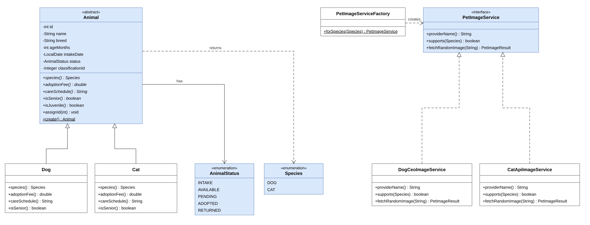
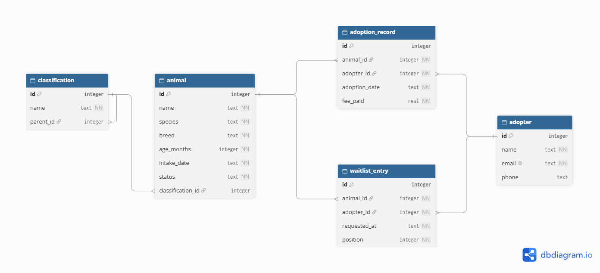

# Pet Shelter & Adoption Tracker
## Project Design Document

| Field | Details | 
| ----- | ----- | 
| **Group Name / No.:** | *Group 3* | 
| **Members:** |  | 
|  | *Shann Michael Agang - UI Designer / Developer* | 
|  | *Sofia Yvonne Enovero - Team Lead / Developer* | 
|  | *Kyle Cheznie Taghoy - Quality Assurance* | 
|  | *Aeisha Mae Elizar - Database Admin* | 
|  | *Cleint Lausa - Developer* | 
| **Instructor:** | Richyll Son | 
| **Term:** | First Semester, S.Y. 2026-2027 | 
| **Document Version / Date:** | *V 0.3 - 11/07/2026* | 

<br>

# Table of Contents

- Pet Shelter & Adoption Tracker  ....................................................................................................................... 1
  - Table of Contents ............................................................................................................................... 2
  - Revision History .................................................................................................................................. 3
  - 1. Introduction & Project Overview ........................................................................................ 3
  - 2. Preliminary ER Sketch & Team Roles ................................................................................. 4
    - Table 1: Preliminary Entities and Key Attributes ....................................................... 5
    - Table 2: Preliminary Relationships and Cardinality ................................................... 5
    - Table 3: Team Members and Primary Roles ................................................................ 5
  - 3. System Architecture & Object-Oriented Design ........................................................... 6
    - 3.1 Class Hierarchy - PawTrack: Pet Shelter & Adoption Tracker ............................. 6
    - 3.2 Single Responsibility Principle Justification Table ................................................ 6
    - 3.3 Design Rationale: PawTrack ............................................................................................ 8
  - 4. Data Model & Database Design ......................................................................................... 9
    - 4.1 ER Diagram ........................................................................................................................... 9
    - 4.2 SQLite Schema ..................................................................................................................... 9

<br>

## Revision History

| Version | Date | Author | Changes |
| :---: | :--- | :--- | :--- |
| 0.1 | Oct 22, 2026 | Sofia Yvonne Enovero | Add section 1 One paragraph Pitch |
| 0.1 | Oct 22, 2026 | Shann Michael Agang | Add Section 2 Entity-Relationship |
| 0.1 | Oct 22, 2026 | Kyle Cheznie Taghoy | Add ER Sketch |
| 0.1 | Oct 23, 2026 | Aeisha Mae Elizar | Update Section 2 Table 2 |
| 0.1 | Oct 23, 2026 | Cleint Lausa | Add Task Split Table |
| 0.2 | Oct. 27, 2026 | Kyle Cheznie Taghoy | Add Class Hierarchy Diagram |
| 0.2 | Oct. 27, 2026 | Cleint Lausa | Update SRP Table |
| 0.2 | Oct. 27, 2026 | Aeisha Mae Elizar | Add Design Rationale |
| 0.2 | Oct. 27, 2026 | Sofia Yvonne Enovero | Update ER diagram |
| 0.2 | Oct. 27, 2026 | Shann Michael Agang | Add Database SQL Schema |

<br>

## 1. Introduction & Project Overview

  The Pet Shelter & Adoption Tracker is a Java desktop application designed to help animal shelter staff manage intake, waitlists, and adoptions in one offline-first tool. Many small shelters rely on scattered spreadsheets and paper records, making it difficult to track animal stays and adoption demand. Our application centralizes these operations: it models species with distinct care schedules, manages adoption waitlists using queues, and enables status undo operations via a stack. Integrated pet APIs (Dog CEO API and TheCatAPI) provide sample pet images. Bulk historical CSV log imports and built-in analytics that render adoption trends and stay durations as bar charts are planned for Milestone 2.

<br>

## 2. Preliminary ER Sketch & Team Roles

### Table 1: Preliminary Entities and Key Attributes

| Entity | Key Attributes |
|---|---|
| Classification | id (PK), name, parent_id (FK → Classification.id) |
| Animal | id (PK), name, species, breed, age_months, intake_date, status, classification_id (FK → Classification.id) |
| Adopter | id (PK), name, email (unique), phone |
| AdoptionRecord | id (PK), animal_id (FK → Animal.id), adopter_id (FK → Adopter.id), adoption_date, fee_paid |
| WaitlistEntry | id (PK), animal_id (FK → Animal.id), adopter_id (FK → Adopter.id), requested_at, position |

### Table 2: Preliminary Relationships and Cardinality

| Parent Entity | Relationship | Child Entity | Foreign Key | Description |
|---|---|---|---|---|
| Classification | 1:M | Classification | parent_id (nullable) | Self-referencing taxonomy tree of any depth, e.g., Dog → Sporting Group → Retriever → Golden Retriever |
| Classification | 1:M | Animal | classification_id | Each animal belongs to one classification |
| Animal | 1:M | AdoptionRecord | animal_id | An animal can have adoption records |
| Adopter | 1:M | AdoptionRecord | adopter_id | An adopter can adopt multiple animals |
| Animal | 1:M | WaitlistEntry | animal_id | An animal can have many adopters waiting |
| Adopter | 1:M | WaitlistEntry | adopter_id | An adopter can wait on multiple animals |

### Table 3: Team Members and Primary Roles

| Member | Primary Responsibility (this milestone) |
| --- | --- |
| Sofia Yvonne Enovero | Team Lead / Developer |
| Shann Michael Agang | UI Designer/Developer |
| Cleint Lausa | Developer |
| Kyle Cheznie Taghoy | QA (Quality Assurance) |
| Aeisha Mae Elizar | Database Admin |

<br>

## 3. System Architecture & Object-Oriented Design
 
### 3.1 Class Hierarchy - PawTrack: Pet Shelter & Adoption Tracker
 


*Figure 3.1 Class hierarchy of PawTrack: the abstract Animal class with its Dog and Cat subclasses, the Species and AnimalStatus enumerations, and the PetImageService interface with its two API implementations.*

<br>

### 3.2 Single Responsibility Principle Justification Table
 
**Table 3.1: Class hierarchy (animals)**
 
| Class | Single responsibility | Why it follows SRP |
|---|---|---|
| **Animal (abstract)** | Holds the data every animal shares (id, name, breed, age, intake date, status, classification) and validates it. It declares the species-specific methods species(), adoptionFee(), careSchedule(), and isSenior(). | It contains no fee rules, no database code, no GUI code, and no API code. It changes only when the shared animal data or the contract changes. |
| **Dog** | Applies the dog rules: puppy, standard, and senior fees, the senior age of 84 months, and the dog care schedule. | It changes only when the dog fee or care rules change. |
| **Cat** | Applies the cat rules: kitten, standard, and senior fees, the senior age of 120 months, and the cat care schedule. | It changes only when the cat fee or care rules change. |
| **Species (enum)** | Defines the supported species (DOG, CAT) and their display label. | It changes only when a species is added. |
| **AnimalStatus (enum)** | Defines the animal's status values (INTAKE, AVAILABLE, PENDING, ADOPTED, RETURNED) and converts them to and from labels. | It changes only when the status lifecycle changes. |
 
**Table 3.2: Image API classes**
 
| Class | Single responsibility | Why it follows SRP |
|---|---|---|
| **PetImageService (interface)** | Defines what the app needs from an image source: providerName(), supports(Species), and fetchRandomImage(String). | The GUI depends on this contract, not on a specific API. |
| **DogCeoImageService** | Talks only to the Dog CEO API and parses its JSON response. | It changes only if that API changes. |
| **CatApiImageService** | Talks only to TheCatAPI (including the optional API key) and parses its JSON response. | It changes only if that API changes. |
| **PetImageServiceFactory** | Chooses the right PetImageService for a species. | Selection logic stays out of the GUI and the services. |
| **PetImageResult** | Holds one fetched image result (URL, species, breed, provider). | It is data only, with no behavior. |
| **HttpJson** | Performs the HTTP GET request and returns the JSON text. | Network code is in one place, not repeated in each service. |
 
**Table 3.3: Services and data structures**
 
| Class | Single responsibility | Why it follows SRP |
|---|---|---|
| **WaitlistService** | Manages each animal's first-come, first-served queue of interested adopters. | It holds only queue logic, with no database or GUI code. |
| **StatusHistoryService** | Manages the undo stack of status changes. | It holds only stack logic. |
| **StatusChange** | Holds one status change (animal, from, to) for the undo stack. | Data only. |
| **ClassificationService** | Searches the classification tree recursively and builds the breed paths. | It holds only tree-search logic. |
| **ClassificationNode** | Represents one node in the classification tree and walks its children recursively. | It models one tree node and nothing else. |
| **ShelterSeeder** | Fills an empty database with sample animals. | Demo data is kept out of the other classes. |

**Table 3.4: Database layer**
 
| Class | Single responsibility | Why it follows SRP |
|---|---|---|
| **Database** | Opens the SQLite connection, enables foreign keys, and creates the tables. | Connection and schema setup in one place. |
| **AnimalDao, AdopterDao, AdoptionRecordDao, ClassificationDao, WaitlistDao** | Each runs the SQL for one table, using PreparedStatement for every query that takes input. | One class per table, so a change to one table doesn't touch the others. |
| **Adopter, AdoptionRecord** | Hold adopter and adoption data. | Data only. |
 
**Table 3.5: GUI layer**
 
| Class | Single responsibility | Why it follows SRP |
|---|---|---|
| **MainFrame** | Builds the window and connects the controls to the services and DAOs. | It handles screen events and delegates the real work to other classes. |
| **AnimalTableModel** | Feeds animal data to the table. | Display only. |
| **ImageWorker** | Downloads the sample image on a background thread, so the window doesn't freeze. | Threading for images is in one class. |

<br>

### 3.3 Design Rationale: PawTrack
 
The system is built around an abstract Animal class that stores the data every animal shares (id, name, breed, age in months, intake date, status, and classification) and validates it. It declares the behavior that differs by species: species(), adoptionFee(), careSchedule(), and isSenior(). Dog and Cat extend Animal and implement only their own rules: the fee for juvenile, standard, and senior animals, the senior age threshold, and the care schedule. The rest of the application works with Animal references and calls these methods without checking the species, so the same code serves both. A static Animal.create() factory builds the right subclass from a Species, and two enums, Species and AnimalStatus, keep the allowed species and status values in one place.
 
This follows the Single Responsibility Principle. Animal models shared animal data and the contract, and each subclass owns the rules for one species. None of them contains database, GUI, or API code. Those concerns are in separate classes: DAO classes, one per table, run the SQL for their table and use PreparedStatement for every query that takes input. Services hold the data-structure logic: WaitlistService keeps a first-in, first-out queue of interested adopters, StatusHistoryService keeps the undo stack, and ClassificationService searches the classification tree recursively. Pet images are fetched through the PetImageService interface, with DogCeoImageService and CatApiImageService each responsible for one external API and its JSON, and PetImageServiceFactory choosing the right one. The GUI depends only on the interface, so an API can be changed, replaced, or fail without touching the animal classes, and ImageWorker keeps downloads off the Swing event thread so the window stays responsive.

<br>

## 4. Data Model & Database Design

### 4.1 ER Diagram
 

 
*Figure 4.1 Finalized ERD. PK = primary key, FK = foreign key, NN = NOT NULL*

This section supersedes the preliminary ER sketch in Section 2.

Notes on the diagram:

- `parent_id` in `classification` and `classification_id` in `animal` may be empty (NULL): a top-level classification has no parent, and an animal may have no classification.
- `waitlist_entry` has a unique pair (`animal_id`, `adopter_id`), so an adopter can join the waitlist of an animal only once.
- The foreign keys in `adoption_record` and `waitlist_entry`, and `parent_id` in `classification`, use `ON DELETE CASCADE`.

<br>

### 4.2 SQLite Schema

The database file is `pawtrack.db`. It is created automatically by `Database.java` on first run, and the app runs `PRAGMA foreign_keys = ON` on every connection.

*Listing 4.1 SQLite schema (CREATE TABLE statements)*

```sql
CREATE TABLE IF NOT EXISTS classification (
  id INTEGER PRIMARY KEY AUTOINCREMENT,
  name TEXT NOT NULL,
  parent_id INTEGER REFERENCES classification(id) ON DELETE CASCADE
);

CREATE TABLE IF NOT EXISTS adopter (
  id INTEGER PRIMARY KEY AUTOINCREMENT,
  name TEXT NOT NULL,
  email TEXT NOT NULL COLLATE NOCASE UNIQUE,
  phone TEXT
);

CREATE TABLE IF NOT EXISTS animal (
  id INTEGER PRIMARY KEY AUTOINCREMENT,
  name TEXT NOT NULL,
  species TEXT NOT NULL,
  breed TEXT NOT NULL,
  age_months INTEGER NOT NULL CHECK (age_months >= 0),
  intake_date TEXT NOT NULL,
  status TEXT NOT NULL,
  classification_id INTEGER REFERENCES classification(id)
);

CREATE TABLE IF NOT EXISTS adoption_record (
  id INTEGER PRIMARY KEY AUTOINCREMENT,
  animal_id INTEGER NOT NULL REFERENCES animal(id) ON DELETE CASCADE,
  adopter_id INTEGER NOT NULL REFERENCES adopter(id) ON DELETE CASCADE,
  adoption_date TEXT NOT NULL,
  fee_paid REAL NOT NULL DEFAULT 0
);

CREATE TABLE IF NOT EXISTS waitlist_entry (
  id INTEGER PRIMARY KEY AUTOINCREMENT,
  animal_id INTEGER NOT NULL REFERENCES animal(id) ON DELETE CASCADE,
  adopter_id INTEGER NOT NULL REFERENCES adopter(id) ON DELETE CASCADE,
  requested_at TEXT NOT NULL,
  position INTEGER NOT NULL,
  UNIQUE(animal_id, adopter_id)
);
```
