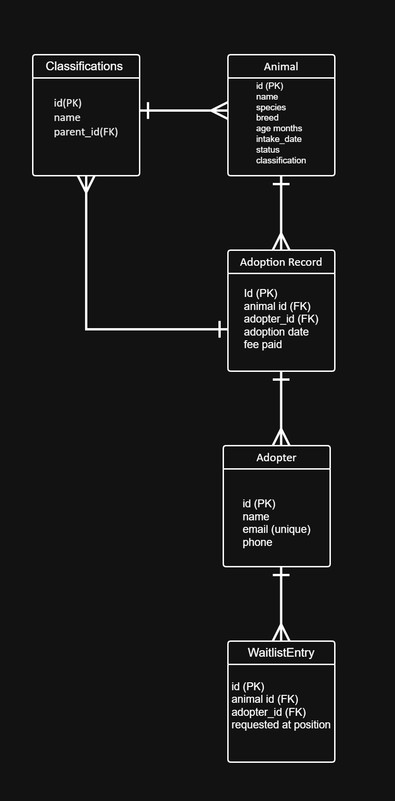
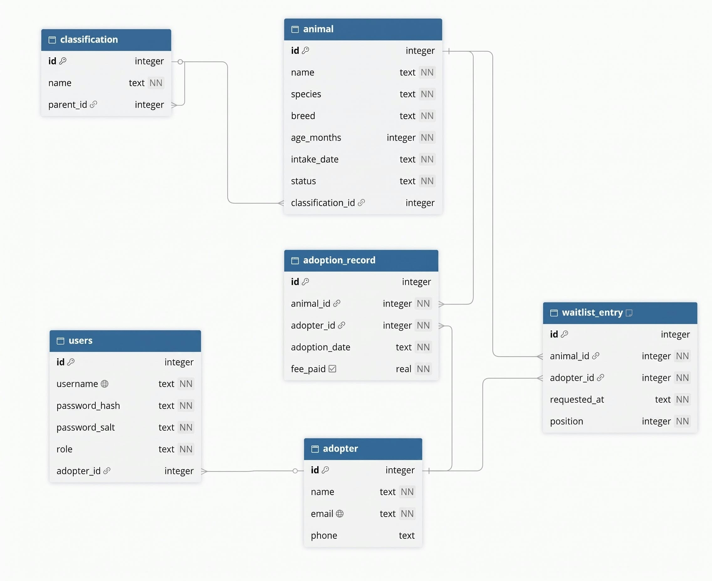

# Pet Shelter & Adoption Tracker
## Project Design Document

| Field | Details | 
| ----- | ----- | 
| **Group Name / No.:** | *Group 3* | 
| **Members:** |  | 
|  | *Shann Michael Agang - UI Designer / Developer* | 
|  | *Sofia Yvonne Enovero - Team Lead / Developer* | 
|  | *Kyle Cheznie Taghoy - Quality Assurance* | 
|  | *Aeisha Mae Elizar - Database Admin* | 
|  | *Cleint Lausa - Developer* | 
| **Instructor:** | Richyll Son | 
| **Term:** | First Semester, S.Y. 2026-2027 | 
| **Document Version / Date:** | *V 0.3 - 11/07/2026* | 

<br>

# Table of Contents

- Pet Shelter & Adoption Tracker  ....................................................................................................................... 1
  - Table of Contents ............................................................................................................................... 2
  - Revision History .................................................................................................................................. 3
  - 1. Introduction & Project Overview ........................................................................................ 3
  - 2. Preliminary ER Sketch & Team Roles ................................................................................. 4
    - Table 1: Preliminary Entities and Key Attributes ....................................................... 5
    - Table 2: Preliminary Relationships and Cardinality ................................................... 5
    - Table 3: Team Members and Primary Roles ................................................................ 5
  - 3. System Architecture & Object-Oriented Design ........................................................... 6
    - 3.1 Class Hierarchy - PawTrack: Pet Shelter & Adoption Tracker ............................. 6
    - 3.2 Single Responsibility Principle Justification Table ................................................ 6
    - 3.3 Design Rationale: PawTrack ............................................................................................ 8
  - 4. Data Model & Database Design ......................................................................................... 9
    - 4.1 ER Diagram ........................................................................................................................... 9
    - 4.2 SQLite Schema ..................................................................................................................... 9

<br>

## Revision History

| Version | Date | Author | Changes |
| :---: | :--- | :--- | :--- |
| 0.1 | Oct 22, 2026 | Sofia Yvonne Enovero | Add section 1 One paragraph Pitch |
| 0.1 | Oct 22, 2026 | Shann Michael Agang | Add Section 2 Entity-Relationship |
| 0.1 | Oct 22, 2026 | Kyle Cheznie Taghoy | Add ER Sketch |
| 0.1 | Oct 23, 2026 | Aeisha Mae Elizar | Update Section 2 Table 2 |
| 0.1 | Oct 23, 2026 | Cleint Lausa | Add Task Split Table |
| 0.2 | Oct. 27, 2026 | Kyle Cheznie Taghoy | Add Class Hierarchy Diagram |
| 0.2 | Oct. 27, 2026 | Cleint Lausa | Update SRP Table |
| 0.2 | Oct. 27, 2026 | Aeisha Mae Elizar | Add Design Rationale |
| 0.2 | Oct. 27, 2026 | Sofia Yvonne Enovero | Update ER diagram |
| 0.2 | Oct. 27, 2026 | Shann Michael Agang | Add Database SQL Schema |

<br>

## 1. Introduction & Project Overview

  The Pet Shelter & Adoption Tracker (PawTrack, project Option P) is a Java desktop application that helps animal-shelter staff manage animal records, adopter information, adoption waitlists, and adoption history in one tool. Many small shelters rely on scattered spreadsheets and paper records, which makes it hard to track how long animals stay and how much demand each animal has. PawTrack centralizes this work: it models dogs and cats with species-specific fees and care schedules, keeps a first-come, first-served waitlist for each animal, supports undo of status changes, organizes breeds in a classification tree, imports historical intake logs from CSV files, and shows adoption trends and stay lengths as bar charts. Two public APIs (Dog CEO and TheCatAPI) supply sample pet images.

PawTrack is built with Java 17, Java Swing, SQLite through JDBC, and Maven (Gson and org.json for JSON, JUnit 5 for tests). Users sign in with one of two roles. STAFF accounts have the full toolset: adding, editing, and deleting animals, CSV import and export, marking animals adopted, undoing status changes, the analytics dashboard, the activity log, and the waitlist requests tab. ADOPTER accounts can be created from the login screen; they can browse and filter animals, record adoption interest, fetch sample images, and view their own records. Passwords are stored only as salted PBKDF2 hashes. All core operations run locally against the SQLite database; an internet connection is needed only to retrieve pet images.
<br>

## 2. Preliminary ER Sketch & Team Roles

## 2. Preliminary ER Sketch & Team Roles

This section records the team's Week 8 plan. It was superseded by the finalized ERD in Section 4, which adds the `users` table for login.

### 2.1 Preliminary ER sketch



*Figure 1: Preliminary ER sketch from the Week 8 proposal (five entities; the self-reference on Classification represents the taxonomy tree).*

### 2.2 Preliminary entities and key attributes

**Table 1: Preliminary entities and key attributes**

| Entity | Key attributes | Description |
|---|---|---|
| Classification | id (PK), name, parent_id (FK → Classification.id, nullable) | Stores animal classifications and supports hierarchical parent-child relationships. |
| Animal | id (PK), name, species, breed, age_months, intake_date, status, classification_id (FK → Classification.id) | Stores animal information, shelter intake details, current status, and classification. |
| Adopter | id (PK), name, email (unique), phone | Stores information about individuals interested in adopting animals. |
| AdoptionRecord | id (PK), animal_id (FK → Animal.id), adopter_id (FK → Adopter.id), adoption_date, fee_paid | Records completed adoptions with their animal and adopter. |
| WaitlistEntry | id (PK), animal_id (FK → Animal.id), adopter_id (FK → Adopter.id), requested_at, position | Records adoption interest and keeps the order of prospective adopters for an animal. |

### 2.3 Preliminary relationships and cardinality

**Table 2: Preliminary relationships and cardinality**

| Parent entity | Cardinality | Child entity | Foreign key | Description |
|---|---|---|---|---|
| Classification | 1:M | Classification | parent_id (nullable) | Self-referencing taxonomy tree of any depth, e.g. Dog > Sporting Group > Retriever > Golden Retriever. |
| Classification | 1:M | Animal | classification_id | Each animal may belong to one classification. |
| Animal | 1:M | AdoptionRecord | animal_id | An animal can have adoption records over time. |
| Adopter | 1:M | AdoptionRecord | adopter_id | An adopter can adopt multiple animals. |
| Animal | 1:M | WaitlistEntry | animal_id | An animal can have many adopters waiting. |
| Adopter | 1:M | WaitlistEntry | adopter_id | An adopter can wait on multiple animals. |

### 2.4 Team members and primary roles

**Table 3: Team members and primary roles**

| Member | Primary responsibility |
|---|---|
| Sofia Yvonne Enovero | Team Lead / Developer |
| Shann Michael Agang | UI Designer / Developer |
| Cleint Lausa | Developer |
| Kyle Cheznie Taghoy | QA (Quality Assurance) |
| Aeisha Mae Elizar | Database Admin |

---
<br>

### 3.1 Class Hierarchy – PawTrack: Pet Shelter & Adoption Tracker

The animal model is an abstract `Animal` class with two concrete subclasses, `Dog` and `Cat`, plus the `Species` and `AnimalStatus` enumerations. Image retrieval is a second hierarchy: the `PetImageService` interface with two implementations, selected by `PetImageServiceFactory`. Polymorphism is exercised at runtime: the rest of the program calls `adoptionFee()`, `careSchedule()`, and `isSenior()` through `Animal` references, and calls `fetchRandomImage()` through `PetImageService`, without checking the concrete type.


### 3.2 Single Responsibility Principle Justification Table

**Table 4: Animal class hierarchy**

| Class | Single responsibility | Why it follows SRP |
|---|---|---|
| **Animal** (abstract) | Holds the data every animal shares (id, name, breed, age, intake date, status, classification) and validates it. Declares `species()`, `adoptionFee()`, `careSchedule()`, and `isSenior()`; `create()` builds the right subclass. | Contains no fee rules, database, GUI, or API code. Changes only when shared animal data or the common contract changes. |
| **Dog** | Applies the dog rules: puppy, standard, and senior fees (300 / 250 / 100), senior age of 84 months, and the dog care schedule. | Changes only when dog-specific fee or care rules change. |
| **Cat** | Applies the cat rules: kitten, standard, and senior fees (200 / 150 / 75), senior age of 120 months, and the cat care schedule. | Changes only when cat-specific fee or care rules change. |
| **Species** (enum) | Defines the supported species (DOG, CAT) and their display labels. | Changes only when a species is added. |
| **AnimalStatus** (enum) | Defines the status values (INTAKE, AVAILABLE, PENDING, ADOPTED, RETURNED) and converts them to and from labels. | Changes only when the status lifecycle or its labels change. |

**Table 5: Image API and DTO classes**

| Class | Single responsibility | Why it follows SRP |
|---|---|---|
| **PetImageService** (interface) | Defines what the app needs from an image source: `providerName()`, `supports(Species)`, `fetchRandomImage(String)`. | The GUI depends on a common interface, not on a specific provider. |
| **DogCeoImageService** | Talks to the Dog CEO API and parses its JSON. | Changes only when the Dog CEO integration changes. |
| **CatApiImageService** | Talks to TheCatAPI, handles its optional API key, and parses its JSON. | Changes only when the TheCatAPI integration changes. |
| **PetImageServiceFactory** | Selects the `PetImageService` for a species. | Provider selection stays out of the GUI and the services. |
| **PetImageResult** | Holds one image result (URL, species, breed, provider). | Data only; no request or GUI logic. |
| **HttpJson** | Performs HTTP GET requests (with timeouts and status checks) and returns JSON text or image bytes. | Network code is centralized, not repeated in each service. |
| **DogCeoResponse, CatImageDto** | One record per JSON shape returned by the APIs (parsed with Gson). | Each only mirrors a response shape. |
| **ApiResult** | Sealed result type with Ok, Empty, and Failed states for API outcomes. | Describes an outcome only; holds no behavior. |

**Table 6: Services and data structures**

| Class | Single responsibility | Why it follows SRP |
|---|---|---|
| **WaitlistService** | Manages each animal's first-come, first-served queue of interested adopters. | Queue logic only; no database or GUI code. |
| **StatusHistoryService** | Manages the stack of status changes that supports undo. | Stack logic only. |
| **StatusChange** | Holds one status change (animal, previous status, new status). | Data only; does not run the undo. |
| **ClassificationService** | Searches the classification tree recursively, builds paths, and classifies breeds. | Tree operations are separate from the node structure. |
| **ClassificationNode** | Represents one tree node and its children. | Stores structure only. |
| **AnalyticsService / AnalyticsReport** | Runs the frequency, average, and recursive roll-up analysis; the report holds the immutable results. | Analysis is separate from the database and the chart. |
| **CsvImportService** (with CsvRow, CsvImportResult, ImportListener) | Parses, validates, and imports CSV rows; reports progress and a summary. | CSV logic is separate from the GUI. |
| **ShelterSeeder** | Fills an empty database with sample data. | Demo data is kept out of regular operations. |

**Table 7: Controllers**

| Class | Single responsibility | Why it follows SRP |
|---|---|---|
| **AnimalController** | Loads, adds, updates, and deletes animals and tracks the selected animal. | The window calls it instead of using the DAO directly. |
| **AdoptionController** | Marks animals adopted (staff only, inside a database transaction), records interest, and undoes the last status change. | Adoption workflow in one place. |
| **WaitlistController** | Records interest, advances the queue, and lists waitlist requests. | Coordinates the waitlist service and DAOs. |
| **ClassificationController** | Filters animals by classification path. | Wraps classification lookups for the GUI. |
| **ImportController** | Checks staff access and runs the CSV import in a background worker. | Keeps threading and permission checks out of the view. |
| **AnalyticsController** | Reads animals and adoption records and builds the analytics snapshot. | Separates data gathering from drawing. |
| **AuthController** | Handles login, logout, account creation, and the `requireStaff()` permission check. | Authentication is centralized instead of in the login screen. |

**Table 8: Database and security layers**

| Class | Single responsibility | Why it follows SRP |
|---|---|---|
| **Database** | Opens the SQLite connection, enables foreign keys, creates the six tables, provides begin/commit/rollback, and seeds two default accounts on an empty database. | Connection and schema setup in one place. |
| **AnimalDao, AdopterDao, AdoptionRecordDao, ClassificationDao, WaitlistDao, UserDao** | Each runs the SQL for one table using prepared statements. | One class per table. |
| **Adopter, AdoptionRecord, User, Role** | Hold adopter, adoption, account data, and the STAFF / ADOPTER roles. | Data only. |
| **PasswordHasher** | Hashes and verifies passwords with PBKDF2 (HmacSHA256, 65,536 iterations, random 16-byte salt) and a constant-time comparison. | Password processing is isolated from login screens. |
| **PasswordPolicy** | Enforces the new-password rules: at least 8 characters with a letter, a number, and a symbol. | Rules change in one place. |

**Table 9: GUI layer**

| Class | Single responsibility | Why it follows SRP |
|---|---|---|
| **MainFrame** | Builds the main window, shows tabs by role, and connects controls to controllers and services. | Handles screen events and delegates the work. |
| **LoginPanel, CreateAccountPanel** | Login screen and adopter account registration screen. | Input screens only; authentication is in AuthController. |
| **AnimalTableModel** | Supplies animal data to the Swing table. | Presentation of table rows only. |
| **AnalyticsPanel, BarChartPanel** | Dashboard (metric dropdown, summary, refresh) and the bar chart drawing. | Display only; the mining is in AnalyticsService. |
| **ImageWorker, ImportWorker** | Background workers for image loading and CSV import. | Long-running work stays off the Event Dispatch Thread. |
| **RoundedUi, Icons** | Custom-styled Swing components and application icon loading. | Look-and-feel helpers separate from screens. |

### 3.3 Design Rationale: PawTrack

PawTrack uses object-oriented design, a few well-known patterns, and basic data structures to stay organized and maintainable. An abstract `Animal` class holds the shared data and declares the behavior that differs by species; `Dog` and `Cat` implement only their own fee, senior-age, and care rules, and `Animal.create()` is a factory that builds the right subclass. The rest of the application works with `Animal` references, so the same code serves both species.

Responsibilities are split by layer. DAO classes (one per table) run SQL with prepared statements; services hold business logic and data structures (a queue for waitlists, a stack for undo, a tree for classification); controllers coordinate services and DAOs and enforce permissions; the Swing classes display data and react to clicks. Pet images are fetched through the `PetImageService` interface, so an API can change or fail without touching the animal classes, and `PetImageServiceFactory` chooses the provider. Long operations run in `SwingWorker`s to keep the interface responsive. Access control uses two roles: the UI shows only the tools allowed for the signed-in role, and `AuthController.requireStaff()` blocks staff-only actions such as importing data and marking animals adopted.

---

## 4. Data Model & Database Design

### 4.1 ER Diagram



*Figure 3: Finalized ERD (six tables). PK = primary key, FK = foreign key, NN = NOT NULL. A crow's foot marks the "many" side; a circle marks an optional link.*

This section supersedes the preliminary ER sketch in Section 2. Notes on the diagram:

- `parent_id` in `classification` and `classification_id` in `animal` may be empty: a top-level classification has no parent, and an animal may have no classification.
- `waitlist_entry` has a unique pair (`animal_id`, `adopter_id`), so an adopter can join an animal's waitlist only once.
- The foreign keys in `adoption_record` and `waitlist_entry`, and `parent_id` in `classification`, use `ON DELETE CASCADE`.
- `users.adopter_id` optionally links an adopter account to an adopter record; `role` is limited to STAFF or ADOPTER.

### 4.2 SQLite Schema

The database file is `petshelter.db` (the path can be changed with the `petshelter.db` system property). `Database.java` creates the tables on first run and runs `PRAGMA foreign_keys = ON` on every connection.

**Table 10: SQLite schema**

| Table | Columns and constraints |
|---|---|
| classification | `id` INTEGER PK AUTOINCREMENT; `name` TEXT NOT NULL; `parent_id` INTEGER → classification(id) ON DELETE CASCADE |
| adopter | `id` INTEGER PK AUTOINCREMENT; `name` TEXT NOT NULL; `email` TEXT NOT NULL UNIQUE (NOCASE); `phone` TEXT |
| animal | `id` INTEGER PK AUTOINCREMENT; `name`, `species`, `breed` TEXT NOT NULL; `age_months` INTEGER NOT NULL CHECK (>= 0); `intake_date`, `status` TEXT NOT NULL; `classification_id` INTEGER → classification(id) |
| adoption_record | `id` INTEGER PK AUTOINCREMENT; `animal_id` INTEGER NOT NULL → animal(id) ON DELETE CASCADE; `adopter_id` INTEGER NOT NULL → adopter(id) ON DELETE CASCADE; `adoption_date` TEXT NOT NULL; `fee_paid` REAL NOT NULL DEFAULT 0 |
| waitlist_entry | `id` INTEGER PK AUTOINCREMENT; `animal_id` INTEGER NOT NULL → animal(id) ON DELETE CASCADE; `adopter_id` INTEGER NOT NULL → adopter(id) ON DELETE CASCADE; `requested_at` TEXT NOT NULL; `position` INTEGER NOT NULL; UNIQUE(`animal_id`, `adopter_id`) |
| users | `id` INTEGER PK AUTOINCREMENT; `username` TEXT NOT NULL UNIQUE; `password_hash`, `password_salt` TEXT NOT NULL; `role` TEXT NOT NULL CHECK (role IN ('STAFF','ADOPTER')); `adopter_id` INTEGER → adopter(id) |

*Listing 1: The `users` table (added for login). The other CREATE TABLE statements are in `Database.initSchema()`.*

```sql
CREATE TABLE IF NOT EXISTS users (
  id INTEGER PRIMARY KEY AUTOINCREMENT,
  username TEXT NOT NULL UNIQUE,
  password_hash TEXT NOT NULL,
  password_salt TEXT NOT NULL,
  role TEXT NOT NULL CHECK (role IN ('STAFF','ADOPTER')),
  adopter_id INTEGER REFERENCES adopter(id)
);
```

---

