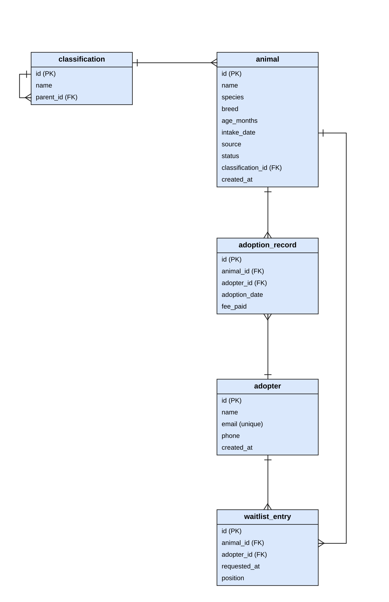

## cpe314--69323--capstone-team-03

# CPE 314 — Software Design & Software Design Laboratory

## Week 8 — Project Proposal

| Field | Details |
|---------|---------|
| **Group Name / No.** | **Group 3** |
| **Members** | Shann Michael Agang - UI Designer |
|  | Sofia Yvonne Enovero - Team Lead / Developer |
|  | Kyle Cheznie Taghoy - QA (Quality Assurance) |
|  | Aeisha Mae Elizar - Database Admin |
|  | Cleint Lausa - Developer |
| **Repository URL** | `cpe314--69323--capstone-team-03` |
| **Theme** | Pet Shelter & Adaptation Tracker |
| **API You Will Use** | - https://dog.ceo/dog-api/documentation - https://thecatapi.com |

---

## 1. One paragraph Pitch 

PawTrack (Pet Shelter & Adoption Tracker) is a Java-based desktop application designed to streamline animal shelter operations by providing an organized system for managing animal records, adopter information, adoption waitlists, and adoption activities. It enables shelter staff to maintain animal records, manage adoption interests, track adoption progress, import animal data through CSV files, and generate analytics to support shelter operations and decision-making. The system uses object-oriented programming principles, data structures, Java Swing, SQLite, and JDBC to provide its core functionalities, with STAFF and ADOPTER roles for secure access. It also integrates external APIs to retrieve sample dog and cat images, requiring an internet connection only for image retrieval while core operations remain locally accessible through the SQLite database.

  

## 2. Entity-Relationship Sketch

### Entity Attributes

| Entity | Key Attributes |
|---|---|
| Classification | id (PK), name, parent_id (FK → Classification.id, nullable) |
| Animal | id (PK), name, species, breed, age_months, intake_date, status, classification_id (FK → Classification.id) |
| Adopter | id (PK), name, email (unique), phone |
| AdoptionRecord | id (PK), animal_id (FK → Animal.id), adopter_id (FK → Adopter.id), adoption_date, fee_paid |
| WaitlistEntry | id (PK), animal_id (FK → Animal.id), adopter_id (FK → Adopter.id), requested_at, position |
| User | id (PK), username (unique), password_hash, role, adopter_id (FK → Adopter.id, nullable) |

### Entity Relationships

| Parent Entity | Relationship | Child Entity | Foreign Key | Description |
|---|---|---|---|---|
| Classification | 1:M | Classification | parent_id (nullable) | Self-referencing classification tree that supports multiple levels, e.g., Dog → Sporting Group → Retriever → Golden Retriever. |
| Classification | 1:M | Animal | classification_id | Each animal belongs to one classification. |
| Animal | 1:M | AdoptionRecord | animal_id | An animal can have adoption records. |
| Adopter | 1:M | AdoptionRecord | adopter_id | An adopter can adopt multiple animals. |
| Animal | 1:M | WaitlistEntry | animal_id | An animal can have multiple adopters on its waitlist. |
| Adopter | 1:M | WaitlistEntry | adopter_id | An adopter can be on the waitlists of multiple animals. |
| Adopter	| 1:1	| User | adopter_id (nullable) |	An adopter profile can be linked to a specific user account so they can log in and view their personal waitlist and adoption history. |
 

## 3. Feature Checklist

| Implemented Feature | Requirement(s) It Satisfies |
|---|---|
| Animal types: Dog and Cat (one abstract class and two concrete subclasses) | **Object-Oriented Design:** Uses an abstract `Animal` class with specialized Dog and Cat subclasses that implement their own adoption fees and care schedules. |
| Queue waitlist per animal (first person in line gets served first) | **Data Structure / Recursion:** Uses a Queue to manage adopters waiting for each animal in a first-come, first-served order. |
| Stack to undo last status change | **Data Structure / Recursion:** Uses a Stack to keep track of status changes and support the "Undo Last Action" function. |
| Tree for classifications (Dog > Sporting Group > Retriever > Golden Retriever) searched with recursion | **Data Structure / Recursion:** Uses a hierarchical classification tree and recursive search to find classifications at different levels. |
| JUnit 5 tests (at least 6): fee calculation per subtype, queue order, undo on an empty stack, and recursive search at shallow and deep levels | **Automated Testing:** Tests normal and edge cases for the system's core logic and data structures. |
| SQLite database with PreparedStatement for animals, adopters, adoption records, classifications, and waitlist entries | **Data Modeling + Database:** Stores animal records, adopter information, adoption history, classifications, and waitlist entries locally using SQLite and JDBC. |
| Dog CEO API and TheCatAPI integration, JSON parsing, and sample pet image retrieval | **REST API Consumption:** Sends requests to external APIs, parses JSON responses, and retrieves sample dog and cat images for display in the application. |
| Swing GUI with buttons and combo boxes (list animals, import CSV, record interest, mark adopted, and view analytics) | **Event-Driven GUI:** Provides an interactive interface for shelter staff to manage animal records, record adopter interest, process adoptions, and view analytics. |
| Import historical intake/adoption CSV files on a background thread using SwingWorker | **Concurrency:** Performs CSV imports in the background so the application remains responsive during data processing. |
| Analyze most-adopted breed/species and average shelter stay length | **Data Mining:** Performs data aggregation and frequency analysis to generate useful shelter statistics. |
| Bar chart of the analytics results, with labeled axes and title | **Data Visualization:** Displays analytics results through a properly labeled bar chart. |
| Login authentication with STAFF and ADOPTER roles | **Authentication / Access Control:** Provides secure login, password hashing, and role-based access control to application features according to assigned permissions. |
## 4. Task Split 
| Member | Primary Responsibility (this milestone) |
| --- | --- |
| Sofia Yvonne Enovero | Team Lead |
| Shann Michael Agang | UI Designer/Developer |
| Cleint Lausa | Developer |
| Kyle Cheznie Taghoy | QA (Quality Assurance) |
| Aeisha Mae Elizar | Database Admin |
---

## 5. Public APIs You Plan to Use

### Dog API
- **Website:**  https://dog.ceo/dog-api/documentation
- **Purpose:** Provides free dog images and breed lists without needing an API key.
### Cat API
- **Website:** https://thecatapi.com
- **Purpose:** Provides cat images and breed information; most features require a free API key.

---

## 6. Risks / Open Questions
- The Stack lets staff undo the last status change, but a status change can also create an AdoptionRecord row in SQLite. When staff undo “Adopted” back to “Available”, should the undo also delete that AdoptionRecord and restore the waitlist entry, or should the record stay and be marked as reversed so the shelter’s history is preserved? 
- Breed names returned by the APIs (for example retriever/golden) may not match the nodes of our classification tree. Should an unmatched breed fall back to the Dog or Cat root node so that every animal still receives a classification?
- The adoption waitlist is a Queue held in memory, but waitlist entries are also stored in the waitlist_entry table. Should the queue be rebuilt from that table when the application restarts so that no adopter loses their place in line?
- Our animal types include “Other”, which neither Dog CEO nor TheCatAPI covers. Is it acceptable for those animals to use a placeholder image?

